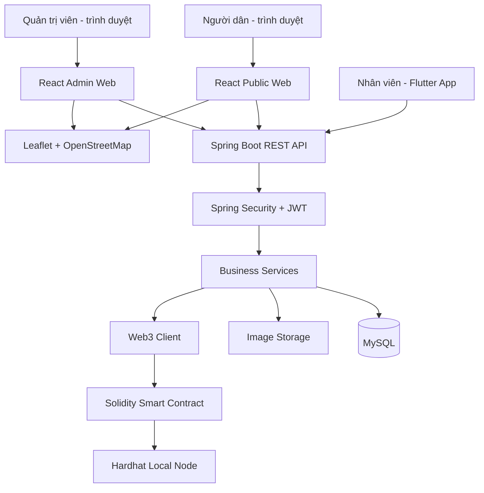
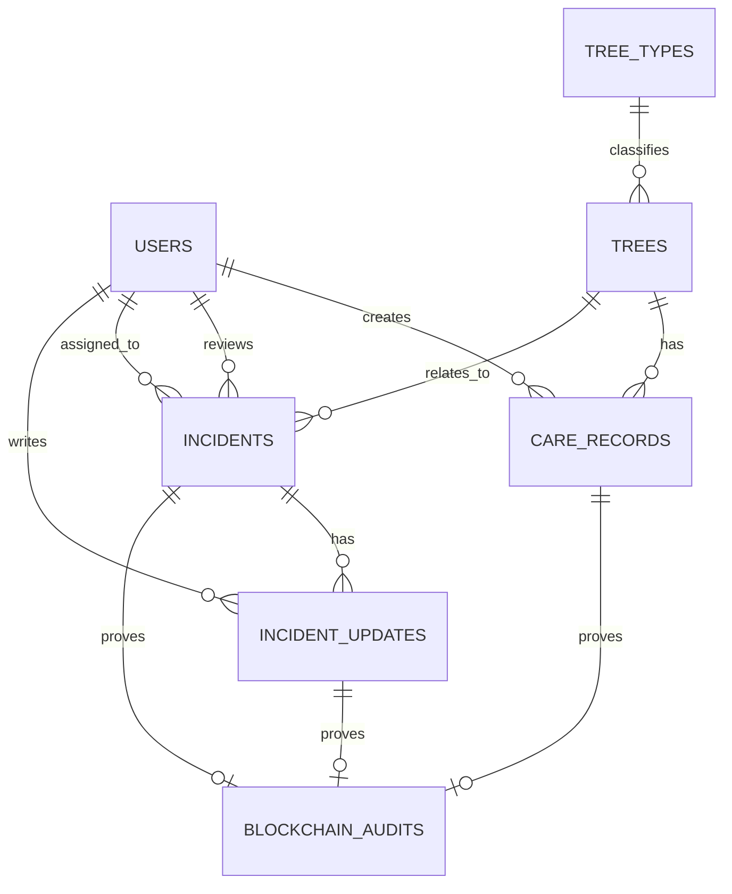

# ROADMAP ĐỒ ÁN 4 — QUẢN LÝ CÂY XANH ĐÔ THỊ TÍCH HỢP QR CODE & BLOCKCHAIN

> Thời lượng: 60 ngày  
> Nhân lực: 2 thành viên  
> Mục tiêu: hoàn thành sản phẩm MVP có thể demo và bảo vệ đồ án  
> Ngân sách: ưu tiên công cụ và dịch vụ miễn phí  
> Trạng thái tài liệu: kế hoạch triển khai đề xuất

---

## 1. Tổng quan đề tài

### 1.1. Tên đề tài đề xuất

**Xây dựng hệ thống quản lý cây xanh đô thị tích hợp QR Code và Blockchain hỗ trợ cập nhật sức khỏe cây, tiếp nhận phản ánh sự cố và xác minh lịch sử xử lý.**

### 1.2. Bài toán

Việc theo dõi cây xanh đô thị có thể gặp các vấn đề như thông tin cây phân tán, khó tra cứu lịch sử chăm sóc, phản ánh cây ngã đổ chưa được chuẩn hóa và khó chứng minh lịch sử dữ liệu có bị chỉnh sửa hay không.

Hệ thống đề xuất quản lý hồ sơ cây xanh tập trung; mỗi cây có một mã định danh và QR riêng. Nhân viên quét QR để cập nhật tình trạng và hoạt động chăm sóc. Người dân quét cùng mã QR để xem thông tin công khai và gửi phản ánh kèm ảnh. Quản trị viên tiếp nhận, phân công và theo dõi việc xử lý. Các sự kiện quan trọng được ghi dấu bằng hash lên Blockchain local để có thể kiểm tra tính toàn vẹn.

### 1.3. Mục tiêu có thể nghiệm thu

1. Quản lý cây xanh, vị trí, loại cây và mã QR.
2. Hiển thị vị trí cây trên bản đồ.
3. Nhân viên đăng nhập, quét QR và ghi nhận tình trạng/chăm sóc cây.
4. Người dân không cần cài ứng dụng, có thể mở trang web từ QR và gửi phản ánh kèm hình ảnh.
5. Admin tiếp nhận, phân công, cập nhật trạng thái và ghi nhận kết quả xử lý sự cố.
6. Dashboard thể hiện số cây, tình trạng cây và số lượng phản ánh theo trạng thái.
7. Smart contract trên Hardhat local ghi dấu hash của bản ghi chăm sóc, phản ánh và nhật ký xử lý.
8. Trang xác minh có thể kiểm tra hash bản ghi trong MySQL so với bằng chứng trên Blockchain.
9. Có tài liệu cài đặt, dữ liệu demo, kiểm thử và kịch bản trình diễn.

### 1.4. Ngoài phạm vi MVP

Không cam kết hoàn thành trong 60 ngày:
- AI dự báo chính xác nguy cơ cây ngã đổ từ ảnh.
- Nhận diện bệnh cây tự động có độ chính xác được kiểm chứng.
- IoT, cảm biến hoặc thiết bị ngoài hiện trường.
- Blockchain public mainnet, token, ví người dùng hoặc thanh toán.
- Tích hợp SMS/Zalo trả phí.
- Ứng dụng người dân riêng; người dân sử dụng web responsive.
- Tối ưu quy hoạch cây xanh toàn thành phố hoặc thuật toán tối ưu mật độ trồng.
- Định danh công dân hoặc tích hợp cơ sở dữ liệu nhà nước.
- Đảm bảo hệ thống vận hành production ở quy mô thành phố.

---

## 2. Cấu hình công nghệ đã chốt

| Thành phần | Công nghệ | Vai trò |
|---|---|---|
| Web Admin | React + TypeScript + Vite | Quản trị cây, nhân viên, sự cố, dashboard, xác minh |
| Web người dân | React + TypeScript + Vite, responsive | Trang cây công khai và gửi phản ánh |
| Mobile nhân viên | Flutter + Dart | Quét QR, cập nhật sức khỏe, ghi nhận chăm sóc, chụp ảnh |
| Backend | Java 17 hoặc 21 + Spring Boot 3.x | REST API, nghiệp vụ, xác thực, phân quyền, tích hợp blockchain |
| Security | Spring Security + JWT | Đăng nhập và phân quyền ADMIN / STAFF |
| ORM | Spring Data JPA + Hibernate | Truy cập MySQL |
| Database | MySQL 8 | Dữ liệu nghiệp vụ chính |
| Blockchain | Solidity + Hardhat local EVM | Ghi dấu hash và sự kiện |
| Kết nối Blockchain | Web3j hoặc thư viện Java tương thích EVM | Backend gọi smart contract |
| Bản đồ | Leaflet + OpenStreetMap | Hiển thị cây và vị trí sự cố |
| QR | Thư viện tạo QR ở backend hoặc frontend | Mỗi cây có URL định danh ổn định |
| Ảnh | Lưu cục bộ khi phát triển; dịch vụ lưu file miễn phí nếu triển khai được | Ảnh cây và ảnh phản ánh |
| Kiểm thử API | Postman | Kiểm tra endpoint và quyền truy cập |
| Kiểm thử web | Vitest/React Testing Library; Playwright nếu đủ thời gian | Kiểm thử giao diện và luồng chính |
| Kiểm thử backend | JUnit + Spring Boot Test | Unit/integration test |
| Quản lý mã nguồn | Git + GitHub | Nhánh, pull request, issue, phiên bản |
| Thiết kế | Figma hoặc diagrams.net | Wireframe và sơ đồ kiến trúc |

### 2.1. Lưu ý về triển khai miễn phí

- Hardhat local là Blockchain chạy trên máy phát triển; không phải Blockchain công khai. Khi demo, phải chạy node Hardhat và triển khai contract trước khi backend sử dụng.
- Dùng Docker Compose để khởi động MySQL và Hardhat local nếu máy hỗ trợ. Nếu không, chạy riêng từng dịch vụ.
- Dùng môi trường local làm phương án demo chính, tránh phụ thuộc vào dịch vụ hosting miễn phí có thể ngủ, giới hạn tài nguyên hoặc thay đổi chính sách.
- OpenStreetMap là dữ liệu bản đồ; tile server công cộng có chính sách sử dụng. Với demo nhỏ, sử dụng hợp lý và ghi rõ nguồn; không coi tile công cộng là dịch vụ có SLA.
- Ảnh nên lưu ngoài thư mục public. Không đưa ảnh, số điện thoại hay thông tin cá nhân lên Blockchain.
- Không lưu mật khẩu, JWT, private key hoặc thông tin bí mật trong Git. Dùng `.env` và file cấu hình mẫu `.env.example`.
- Đối với Web3j, cần kiểm tra phiên bản tương thích với Java và ABI của contract trong ngày thiết lập tích hợp.

### 2.2. Chốt kiến trúc QR

Mỗi cây có một QR, chứa URL ổn định dạng:

`http://localhost:5173/tree/{publicCode}`

Ví dụ: `http://localhost:5173/tree/TREE-0001`

Khi triển khai demo trên mạng LAN hoặc hosting, thay base URL bằng URL tương ứng. QR không chứa thông tin cá nhân hay toàn bộ dữ liệu cây.

Luồng:
- Người dân mở URL công khai, xem thông tin được phép công khai và gửi phản ánh.
- Nhân viên quét cùng QR; ứng dụng Flutter đọc `publicCode`, gọi API lấy hồ sơ. Nếu chưa đăng nhập thì yêu cầu đăng nhập; nếu đã đăng nhập đúng vai trò STAFF thì mở màn hình cập nhật.
- Admin có thể xem cây từ web quản trị.
- Không dựa vào việc biết URL hoặc mã QR để cấp quyền sửa dữ liệu. Mọi hành động ghi dữ liệu đều phải xác thực và phân quyền ở backend.

---

## 3. Vai trò và quyền hạn

| Chức năng | ADMIN | STAFF | Người dân |
|---|---:|---:|---:|
| Đăng nhập | Có | Có | Không bắt buộc |
| Xem dashboard nội bộ | Có | Không hoặc chỉ xem công việc được giao | Không |
| CRUD hồ sơ cây | Có | Không | Không |
| Xem cây công khai qua QR | Có | Có | Có |
| Cập nhật sức khỏe cây | Có thể kiểm tra/sửa theo quyền quản trị | Có | Không |
| Tạo bản ghi chăm sóc | Có thể xem/duyệt | Có | Không |
| Gửi phản ánh sự cố | Có thể tạo thay người dân khi cần | Có thể ghi nhận tại hiện trường | Có |
| Phân công và xử lý phản ánh | Có | Cập nhật công việc được giao | Không |
| Xem tiến độ phản ánh | Có | Theo quyền | Có bằng mã tra cứu |
| Xác minh Blockchain | Có | Có thể xem kết quả | Có thể công khai kết quả tối giản nếu cần |
| Quản lý tài khoản nhân viên | Có | Không | Không |

**Quy tắc:** backend là nơi quyết định quyền. Ẩn nút trên giao diện không thay thế được kiểm tra quyền API.

---

## 4. Kiến trúc hệ thống



### 4.1. Các lớp backend

- **Controller:** nhận HTTP request, kiểm tra dữ liệu đầu vào và trả response.
- **Service:** xử lý nghiệp vụ, phân quyền theo dữ liệu, tạo hash, gọi Blockchain.
- **Repository:** truy cập MySQL qua Spring Data JPA.
- **Entity:** mô hình dữ liệu lưu trữ.
- **DTO:** dữ liệu request/response; không trả entity nhạy cảm trực tiếp.
- **Security:** JWT, password hashing, role-based access control.
- **Blockchain service:** gửi transaction, chờ receipt, đọc event và xác minh hash.
- **File service:** kiểm tra loại/kích thước file, đặt tên file an toàn, lưu file và trả URL nội bộ.

### 4.2. Nguyên tắc ghi Blockchain

1. Tạo bản ghi nghiệp vụ trong MySQL.
2. Chuẩn hóa các trường cần chứng minh, tạo chuỗi JSON/canonical representation ổn định.
3. Tạo SHA-256 hash từ dữ liệu đã chuẩn hóa.
4. Gửi transaction tới smart contract, gồm `recordId`, `recordType`, `dataHash` và thời gian ghi nhận theo thiết kế contract.
5. Lưu transaction hash, block number và trạng thái ghi Blockchain vào bảng audit.
6. Khi xác minh, tính lại hash từ bản ghi hiện tại và so với hash trên Blockchain.

**Xử lý lỗi:** giao dịch Blockchain có thể thất bại dù bản ghi MySQL đã lưu. Không xóa bản ghi nghiệp vụ; ghi trạng thái `PENDING` hoặc `FAILED`, hiển thị cho admin và cho phép retry an toàn. Không giả định transaction đã thành công chỉ vì API đã gửi request.

### 4.3. Mô hình bằng chứng Blockchain

- `recordId`: UUID hoặc mã bản ghi nội bộ, không dùng dữ liệu cá nhân làm ID.
- `recordType`: `CARE`, `INCIDENT`, `RESOLUTION`.
- `dataHash`: hash 32 byte của nội dung canonical.
- `timestamp`: thời gian do contract/node ghi nhận; thời gian nghiệp vụ vẫn lưu trong MySQL.
- `txHash`, `blockNumber`: lưu ở MySQL để tra cứu.
- Contract có event cho phép truy vết bằng công cụ phát triển.
- Contract nên từ chối ghi trùng nếu thiết kế sử dụng `recordId` duy nhất.

Blockchain không chứng minh dữ liệu gốc là sự thật; nó hỗ trợ phát hiện thay đổi sau khi đã ghi dấu.

---

## 5. Database schema đề xuất

Dùng MySQL 8, charset `utf8mb4`, thời gian lưu theo UTC hoặc quy ước thống nhất và hiển thị theo múi giờ Việt Nam. Dùng migration (Flyway hoặc Liquibase) để quản lý schema; nếu thời gian hạn chế có thể dùng một công cụ duy nhất, không trộn lẫn nhiều cách.

### 5.1. Sơ đồ quan hệ khái quát



### 5.2. Bảng `users`

| Cột | Kiểu đề xuất | Quy tắc / ý nghĩa |
|---|---|---|
| id | BIGINT PK | Tự tăng |
| full_name | VARCHAR(120) | Bắt buộc |
| email | VARCHAR(190) | Unique, dùng đăng nhập |
| password_hash | VARCHAR(255) | BCrypt, không lưu mật khẩu thô |
| phone | VARCHAR(30) NULL | Thông tin liên hệ |
| role | ENUM('ADMIN','STAFF') | Vai trò nội bộ |
| status | ENUM('ACTIVE','INACTIVE') | Khóa/mở tài khoản |
| created_at | DATETIME | Thời điểm tạo |
| updated_at | DATETIME | Thời điểm cập nhật |

Không tạo tài khoản người dân bắt buộc cho MVP. Người dân gửi phản ánh bằng form công khai và nhận mã tra cứu ngẫu nhiên khó đoán. Nếu có thu thập thông tin liên hệ, cần nêu rõ mục đích và chỉ thu thập tối thiểu.

### 5.3. Bảng `tree_types`

| Cột | Kiểu đề xuất | Ý nghĩa |
|---|---|---|
| id | BIGINT PK | ID |
| name | VARCHAR(120) | Tên loại cây |
| scientific_name | VARCHAR(160) NULL | Tên khoa học |
| description | TEXT NULL | Mô tả |
| created_at | DATETIME | Thời điểm tạo |

### 5.4. Bảng `trees`

| Cột | Kiểu đề xuất | Quy tắc / ý nghĩa |
|---|---|---|
| id | BIGINT PK | ID nội bộ |
| public_code | VARCHAR(40) UNIQUE | Mã công khai, ví dụ TREE-0001 |
| tree_type_id | BIGINT FK | Loại cây |
| display_name | VARCHAR(150) NULL | Tên hiển thị |
| address | VARCHAR(255) | Địa chỉ/mô tả vị trí |
| latitude | DECIMAL(10,7) NULL | Vĩ độ |
| longitude | DECIMAL(10,7) NULL | Kinh độ |
| planted_at | DATE NULL | Ngày trồng nếu biết |
| estimated_height_m | DECIMAL(6,2) NULL | Chiều cao ước tính |
| trunk_diameter_cm | DECIMAL(6,2) NULL | Đường kính thân ước tính |
| current_health | ENUM('GOOD','FAIR','POOR','DANGER','UNKNOWN') | Trạng thái hiện tại |
| public_note | VARCHAR(500) NULL | Nội dung được phép công khai |
| qr_token | VARCHAR(80) UNIQUE | Token/định danh URL công khai, không phải quyền ghi |
| status | ENUM('ACTIVE','REMOVED','INACTIVE') | Trạng thái hồ sơ |
| created_by | BIGINT FK users | Người tạo |
| created_at | DATETIME | Thời điểm tạo |
| updated_at | DATETIME | Thời điểm cập nhật |

Index đề xuất: `public_code`, `qr_token`, `tree_type_id`, `current_health`, tọa độ nếu cần lọc/hiển thị dữ liệu lớn. MVP có thể tải danh sách cây theo bounding box đơn giản thay vì triển khai hệ thống GIS phức tạp.

### 5.5. Bảng `care_records`

| Cột | Kiểu đề xuất | Ý nghĩa |
|---|---|---|
| id | BIGINT PK | ID |
| record_uuid | CHAR(36) UNIQUE | ID ổn định để tạo bằng chứng |
| tree_id | BIGINT FK | Cây được chăm sóc |
| staff_id | BIGINT FK users | Nhân viên thực hiện |
| health_status | ENUM('GOOD','FAIR','POOR','DANGER','UNKNOWN') | Đánh giá sức khỏe |
| symptoms | TEXT NULL | Dấu hiệu quan sát |
| care_action | ENUM('WATERING','PRUNING','FERTILIZING','INSPECTION','TREATMENT','OTHER') | Hoạt động |
| action_note | TEXT NULL | Mô tả công việc |
| photo_url | VARCHAR(500) NULL | Ảnh liên quan |
| measured_at | DATETIME | Thời gian thực hiện |
| created_at | DATETIME | Thời điểm gửi hệ thống |
| blockchain_status | ENUM('PENDING','CONFIRMED','FAILED','NOT_REQUIRED') | Trạng thái ghi dấu |

Mỗi lần cập nhật phải tạo bản ghi lịch sử mới. Không ghi đè bản ghi cũ để làm mất dấu lịch sử; nếu cần đính chính, tạo bản ghi bổ sung nêu rõ lý do.

### 5.6. Bảng `incidents`

| Cột | Kiểu đề xuất | Ý nghĩa |
|---|---|---|
| id | BIGINT PK | ID |
| incident_uuid | CHAR(36) UNIQUE | ID dùng tạo bằng chứng |
| tracking_code | VARCHAR(32) UNIQUE | Mã tra cứu công khai |
| tree_id | BIGINT NULL FK | Cây liên quan nếu xác định được |
| reporter_name | VARCHAR(120) NULL | Không bắt buộc |
| reporter_contact | VARCHAR(120) NULL | Không bắt buộc; hạn chế thu thập |
| incident_type | ENUM('FALLEN','LEANING','BROKEN_BRANCH','DAMAGE','DISEASE','OTHER') | Loại sự cố |
| description | TEXT | Mô tả |
| photo_url | VARCHAR(500) | Ảnh bằng chứng |
| latitude | DECIMAL(10,7) NULL | Vị trí sự cố |
| longitude | DECIMAL(10,7) NULL | Vị trí sự cố |
| status | ENUM('NEW','VERIFIED','ASSIGNED','IN_PROGRESS','RESOLVED','REJECTED') | Trạng thái |
| priority | ENUM('LOW','MEDIUM','HIGH','URGENT') | Mức ưu tiên |
| assigned_to | BIGINT NULL FK users | Nhân viên được giao |
| reviewed_by | BIGINT NULL FK users | Người xác minh |
| reported_at | DATETIME | Thời điểm gửi |
| updated_at | DATETIME | Thời điểm cập nhật |

Quy tắc riêng tư: không công khai tên/số điện thoại người báo cáo. Mã tra cứu phải khó đoán; endpoint tra cứu chỉ trả thông tin trạng thái tối thiểu. Có giới hạn tốc độ gửi báo cáo và upload ảnh để giảm spam.

### 5.7. Bảng `incident_updates`

| Cột | Kiểu đề xuất | Ý nghĩa |
|---|---|---|
| id | BIGINT PK | ID |
| update_uuid | CHAR(36) UNIQUE | ID bằng chứng |
| incident_id | BIGINT FK | Sự cố |
| actor_id | BIGINT FK users | Người cập nhật |
| old_status | VARCHAR(30) NULL | Trạng thái trước |
| new_status | VARCHAR(30) | Trạng thái sau |
| note | TEXT NULL | Ghi chú xử lý |
| photo_url | VARCHAR(500) NULL | Ảnh kết quả nếu có |
| created_at | DATETIME | Thời điểm |
| blockchain_status | ENUM('PENDING','CONFIRMED','FAILED','NOT_REQUIRED') | Trạng thái ghi dấu |

### 5.8. Bảng `blockchain_audits`

| Cột | Kiểu đề xuất | Ý nghĩa |
|---|---|---|
| id | BIGINT PK | ID |
| record_type | ENUM('CARE','INCIDENT','RESOLUTION') | Loại bản ghi |
| record_uuid | CHAR(36) | UUID bản ghi nghiệp vụ |
| data_hash | CHAR(64) | SHA-256 dạng hex |
| tx_hash | VARCHAR(80) NULL | Transaction hash |
| block_number | BIGINT NULL | Block number |
| chain_id | BIGINT | Chain ID của môi trường |
| status | ENUM('PENDING','CONFIRMED','FAILED') | Trạng thái giao dịch |
| error_message | VARCHAR(500) NULL | Lỗi đã rút gọn, không chứa bí mật |
| created_at | DATETIME | Thời điểm tạo yêu cầu |
| confirmed_at | DATETIME NULL | Thời điểm xác nhận |

Unique key nên đặt trên cặp `(record_type, record_uuid)` nếu mỗi bản ghi chỉ có một bằng chứng chính thức. Nếu cho phép retry, cập nhật trạng thái/tx tương ứng hoặc dùng bảng attempts riêng; không tạo bằng chứng trùng ngoài ý muốn.

### 5.9. Bảng tùy chọn

Chỉ tạo nếu thực sự cần trong MVP:
- `notifications`: thông báo nội bộ cho nhân viên/admin.
- `refresh_tokens`: chỉ nếu dùng refresh token.
- `app_settings`: cấu hình nhỏ như URL public, giới hạn upload.
- `file_assets`: nếu cần quản lý file tập trung thay vì lưu URL trực tiếp.

Không cần tạo bảng riêng cho mọi danh mục nếu không có nghiệp vụ thực tế. Dùng enum cho trạng thái cố định trong MVP; dùng bảng danh mục khi cần quản trị thay đổi.

### 5.10. Quy tắc dữ liệu và migration

- Tất cả FK phải có ràng buộc rõ ràng.
- Không xóa cứng cây đã có lịch sử chăm sóc/sự cố; chuyển trạng thái `INACTIVE` hoặc `REMOVED`.
- Dùng `created_at`, `updated_at` thống nhất.
- Dùng DTO và validation như `@NotBlank`, `@Size`, `@DecimalMin`, kiểm tra latitude trong [-90, 90], longitude trong [-180, 180].
- Chỉ admin được thay đổi hồ sơ cây; nhân viên chỉ được tạo bản ghi chăm sóc và xử lý sự cố được phân công.
- Cập nhật trạng thái sự cố phải tạo `incident_updates` trong cùng transaction MySQL.
- Hash phải dựa trên dữ liệu chuẩn hóa ổn định; không hash trực tiếp JSON có thứ tự key không xác định.
- Trước khi tính hash, xác định rõ trường nào thuộc bằng chứng. Tránh đưa dữ liệu cá nhân không cần thiết vào payload/hash công khai.

---

## 6. Thiết kế API REST

Base URL: `/api/v1`

Quy ước:
- JSON request/response.
- Lỗi có cấu trúc: `timestamp`, `status`, `code`, `message`, `path`, `fieldErrors` nếu có.
- JWT: `Authorization: Bearer <token>`.
- Pagination cho danh sách: `page`, `size`, `sort`.
- API public phải giới hạn dữ liệu trả về và tốc độ gọi.
- Không trả stack trace hoặc thông tin nội bộ cho client.

### 6.1. Authentication

| Method | Endpoint | Quyền | Mục đích |
|---|---|---|---|
| POST | `/auth/login` | Public | Đăng nhập, trả access token |
| GET | `/auth/me` | ADMIN/STAFF | Thông tin tài khoản hiện tại |
| POST | `/auth/logout` | ADMIN/STAFF | Kết thúc phiên phía client; nếu có refresh token thì revoke |

### 6.2. Quản lý cây và loại cây

| Method | Endpoint | Quyền | Mục đích |
|---|---|---|---|
| GET | `/tree-types` | ADMIN/STAFF | Danh sách loại cây |
| POST | `/tree-types` | ADMIN | Tạo loại cây |
| PUT | `/tree-types/{id}` | ADMIN | Sửa loại cây |
| GET | `/trees` | ADMIN/STAFF | Danh sách, lọc theo mã, loại, sức khỏe |
| POST | `/trees` | ADMIN | Tạo cây và sinh định danh QR |
| GET | `/trees/{id}` | ADMIN/STAFF | Chi tiết cây nội bộ |
| PUT | `/trees/{id}` | ADMIN | Cập nhật hồ sơ cây |
| PATCH | `/trees/{id}/status` | ADMIN | Đổi trạng thái hồ sơ |
| GET | `/trees/{id}/qr` | ADMIN | Lấy ảnh QR hoặc dữ liệu URL để in |
| GET | `/public/trees/{publicCode}` | Public | Hồ sơ cây được phép công khai |
| GET | `/public/trees/map` | Public | Cây công khai trong vùng bản đồ |

Query map đề xuất: `minLat`, `maxLat`, `minLng`, `maxLng`. Kiểm tra giới hạn bounding box để tránh trả toàn bộ dữ liệu quá lớn.

### 6.3. Chăm sóc cây

| Method | Endpoint | Quyền | Mục đích |
|---|---|---|---|
| GET | `/trees/{id}/care-records` | ADMIN/STAFF | Lịch sử chăm sóc |
| POST | `/trees/{id}/care-records` | STAFF | Tạo bản ghi chăm sóc |
| GET | `/care-records/{id}` | ADMIN/STAFF | Chi tiết bản ghi |
| GET | `/care-records/{id}/verification` | ADMIN/STAFF | Kiểm tra bằng chứng Blockchain |

Khi tạo bản ghi, backend xác thực nhân viên, kiểm tra cây đang hoạt động, lưu bản ghi MySQL, tạo hash, gửi transaction và trả trạng thái Blockchain. Nếu Blockchain lỗi, phản hồi vẫn phải phân biệt rõ dữ liệu nghiệp vụ đã lưu nhưng bằng chứng chưa được xác nhận.

### 6.4. Báo cáo sự cố công khai

| Method | Endpoint | Quyền | Mục đích |
|---|---|---|---|
| POST | `/public/incidents` | Public | Gửi phản ánh kèm ảnh và thông tin vị trí |
| GET | `/public/incidents/track/{trackingCode}` | Public | Tra cứu trạng thái tối thiểu |
| GET | `/incidents` | ADMIN/STAFF | Danh sách nội bộ, filter trạng thái/loại/ưu tiên |
| GET | `/incidents/{id}` | ADMIN/STAFF | Chi tiết sự cố |
| PATCH | `/incidents/{id}/review` | ADMIN | Xác minh hoặc từ chối phản ánh |
| PATCH | `/incidents/{id}/assign` | ADMIN | Phân công nhân viên |
| POST | `/incidents/{id}/updates` | ADMIN hoặc STAFF được giao | Ghi nhận tiến độ/kết quả |
| GET | `/incidents/{id}/updates` | ADMIN/STAFF có quyền | Lịch sử xử lý |
| GET | `/incidents/{id}/verification` | ADMIN/STAFF | Kiểm tra bằng chứng Blockchain |

### 6.5. Dashboard và thông báo

| Method | Endpoint | Quyền | Mục đích |
|---|---|---|---|
| GET | `/dashboard/summary` | ADMIN | Tổng số cây, cây theo sức khỏe, sự cố theo trạng thái |
| GET | `/dashboard/incidents-trend` | ADMIN | Số phản ánh theo ngày/tháng |
| GET | `/notifications` | ADMIN/STAFF | Danh sách thông báo |
| PATCH | `/notifications/{id}/read` | ADMIN/STAFF là người nhận | Đánh dấu đã đọc |

Thông báo trong MVP là thông báo nội bộ trong ứng dụng/web. Push notification, SMS, Zalo hoặc email tự động là phần mở rộng; không giả định miễn phí và không đưa vào tiêu chí bắt buộc.

### 6.6. Blockchain

| Method | Endpoint | Quyền | Mục đích |
|---|---|---|---|
| GET | `/blockchain/status` | ADMIN | Kiểm tra node, chain ID và contract |
| GET | `/blockchain/audits` | ADMIN | Danh sách bản ghi bằng chứng |
| GET | `/blockchain/verify/{recordType}/{recordUuid}` | ADMIN/STAFF | Tính lại hash và so sánh với Blockchain |
| POST | `/blockchain/audits/{id}/retry` | ADMIN | Thử ghi lại bằng chứng đang lỗi |

Không cho client truyền hash tùy ý để tự xác nhận dữ liệu. Backend phải đọc bản ghi nghiệp vụ có quyền truy cập, tự tính hash và đọc bằng chứng từ contract.

### 6.7. Upload ảnh

Có thể dùng `multipart/form-data` hoặc luồng upload riêng. Cần:
- Chỉ cho phép định dạng ảnh đã xác định (JPEG, PNG, WebP).
- Giới hạn kích thước file.
- Sinh tên file ngẫu nhiên; không dùng nguyên tên file người dùng gửi.
- Kiểm tra MIME và nội dung file; không chỉ tin phần mở rộng.
- Không thực thi file upload.
- Không để ảnh riêng tư ở thư mục có thể liệt kê công khai.
- Có thông báo lỗi rõ ràng khi file quá lớn hoặc sai định dạng.

---

## 7. Quy tắc nghiệp vụ chính

### 7.1. Hồ sơ cây và QR

1. Admin tạo cây, nhập mã, địa chỉ và tọa độ.
2. Hệ thống tạo `public_code` và URL QR.
3. Admin tải/in QR và gắn lên cây trong dữ liệu demo.
4. URL công khai chỉ trả các trường đã cho phép.
5. Thay đổi thông tin cây không làm thay URL QR.
6. Mã QR không cho phép người quét sửa dữ liệu nếu chưa đăng nhập và không có quyền.

### 7.2. Cập nhật sức khỏe

1. Nhân viên đăng nhập.
2. Quét QR hoặc nhập mã cây.
3. Ứng dụng gọi API lấy hồ sơ.
4. Nhân viên chọn tình trạng, hoạt động chăm sóc, ghi chú và ảnh nếu có.
5. Backend kiểm tra quyền và dữ liệu.
6. Tạo bản ghi lịch sử mới, cập nhật tình trạng hiện tại của cây theo quy tắc đã chốt.
7. Tạo hash và ghi Blockchain.
8. Hiển thị kết quả: đã lưu dữ liệu; bằng chứng Blockchain đã xác nhận hoặc đang chờ/thất bại.

### 7.3. Phản ánh của người dân

1. Quét QR hoặc vào trang phản ánh.
2. Nếu từ QR cây, hệ thống tự điền mã cây.
3. Chọn loại sự cố, mô tả, ảnh; vị trí GPS là tùy chọn và cần quyền trình duyệt.
4. Backend kiểm tra ảnh, dữ liệu và chống spam cơ bản.
5. Tạo mã tra cứu ngẫu nhiên.
6. Admin xem báo cáo, kiểm tra, đặt mức ưu tiên và phân công.
7. Nhân viên cập nhật tiến độ, ảnh và kết quả.
8. Mỗi sự kiện quan trọng được ghi dấu Blockchain.
9. Người dân dùng mã tra cứu để xem trạng thái tối thiểu.

### 7.4. Trạng thái sự cố

Luồng thông thường:

`NEW → VERIFIED → ASSIGNED → IN_PROGRESS → RESOLVED`

Có thể chuyển `NEW → REJECTED` khi phản ánh không hợp lệ. Backend phải kiểm tra chuyển trạng thái hợp lệ, ghi người thao tác, thời gian và ghi chú. Không cho phép client tự gửi trạng thái bất kỳ mà bỏ qua quy tắc.

### 7.5. Mức ưu tiên

- `URGENT`: cây đổ chắn đường hoặc nguy hiểm rõ ràng; cần xử lý nhanh.
- `HIGH`: cây nghiêng/gãy cành lớn, có nguy cơ.
- `MEDIUM`: hư hại cần kiểm tra nhưng chưa thấy nguy hiểm tức thời.
- `LOW`: phản ánh thông thường.

Mức ưu tiên là do người tiếp nhận đánh giá; không tự tuyên bố hệ thống có thể xác định mức nguy hiểm chính xác bằng AI.

---

## 8. Roadmap chi tiết 60 ngày

### Tuần 1 — Chốt phạm vi và dựng nền tảng (Ngày 1–7)

| Ngày | Công việc | Kết quả bàn giao |
|---:|---|---|
| 1 | Chốt đề tài, mục tiêu, phạm vi MVP, đối tượng sử dụng, kịch bản demo | Tài liệu scope 1–2 trang |
| 2 | Liệt kê use case, quy tắc quyền ADMIN/STAFF/người dân, trạng thái sự cố | Use case và ma trận quyền |
| 3 | Thiết kế ERD, data dictionary, quy tắc mã cây/QR và tracking code | ERD phiên bản 1 |
| 4 | Vẽ kiến trúc, luồng QR, chăm sóc, phản ánh, Blockchain | Sơ đồ kiến trúc và sequence diagram |
| 5 | Tạo Git repository, branch strategy, issue board, quy tắc commit và README | Repo chạy được khung ban đầu |
| 6 | Khởi tạo Spring Boot, cấu hình MySQL, JPA, migration, cấu trúc package | Backend kết nối DB |
| 7 | Khởi tạo React/Vite và Flutter; thống nhất API convention, cấu hình `.env.example` | Web và mobile chạy skeleton |

**Cổng nghiệm thu tuần 1:** phạm vi đã khóa; ERD và kiến trúc đủ rõ để bắt đầu code; cả ba ứng dụng khởi động được; backend kết nối MySQL.

### Tuần 2 — Database, xác thực và CRUD cây (Ngày 8–14)

| Ngày | Thành viên A — Backend/Blockchain | Thành viên B — Web/Mobile | Kết quả |
|---:|---|---|---|
| 8 | Tạo entity/repository cho users, tree_types, trees | Tạo layout, router và design tokens cho web | Cấu trúc dữ liệu và layout |
| 9 | Seed tài khoản admin/staff demo an toàn; mã hóa mật khẩu BCrypt | Làm màn hình đăng nhập admin và khung Flutter login | Login UI |
| 10 | Xây `/auth/login`, `/auth/me`, JWT và cấu hình Security | Kết nối login web/mobile với API | Đăng nhập hoạt động |
| 11 | Viết role guard và kiểm thử quyền endpoint | Làm sidebar, header, trang danh sách cây | RBAC nền tảng |
| 12 | CRUD loại cây và cây; validation DTO | Làm form tạo/sửa cây, danh sách và filter | CRUD cây |
| 13 | Sinh public code, URL QR ổn định, endpoint lấy QR | Hiển thị QR và trang chi tiết cây nội bộ | Mỗi cây có QR |
| 14 | Viết test backend cho auth/CRUD và sửa lỗi | Kiểm tra responsive và luồng CRUD | Demo CRUD đầu tiên |

**Cổng nghiệm thu tuần 2:** admin đăng nhập được; quyền STAFF không thể gọi API admin; tạo/sửa/xem cây; QR mở đúng hồ sơ công khai.

### Tuần 3 — Bản đồ và cổng người dân (Ngày 15–21)

| Ngày | Thành viên A — Backend | Thành viên B — Web/Mobile | Kết quả |
|---:|---|---|---|
| 15 | API public tree chỉ trả trường được phép công khai | Làm trang hồ sơ cây công khai responsive | Public tree page |
| 16 | API map với bounding box và filter cơ bản | Tích hợp Leaflet, marker cây và popup | Bản đồ cây |
| 17 | Thiết kế endpoint upload ảnh và validation | Form gửi phản ánh, upload ảnh và preview | Form sự cố |
| 18 | Tạo incident, tracking code, kiểm tra dữ liệu đầu vào | Kết nối form với API, trang xác nhận gửi | Gửi phản ánh |
| 19 | API tra cứu trạng thái bằng tracking code, giới hạn dữ liệu trả về | Trang tra cứu tiến độ công khai | Người dân tra cứu |
| 20 | Thêm xử lý lỗi, giới hạn file và chống spam cơ bản | Hoàn thiện giao diện mobile/responsive | Luồng public ổn định |
| 21 | Kiểm thử API và rà soát rò rỉ dữ liệu công khai | Test quét QR bằng camera điện thoại và trình duyệt | Demo QR + phản ánh |

**Cổng nghiệm thu tuần 3:** QR mở web người dân; người dân xem cây, gửi ảnh phản ánh và tra cứu được trạng thái. Bản đồ hiển thị cây có tọa độ.

### Tuần 4 — Mobile nhân viên và chăm sóc cây (Ngày 22–28)

| Ngày | Thành viên A — Backend | Thành viên B — Flutter | Kết quả |
|---:|---|---|---|
| 22 | CRUD/lịch sử care records, DTO và validation | Tạo navigation, session/login và trạng thái đăng nhập | Khung mobile |
| 23 | Endpoint tra cứu cây bằng public code/token | Tích hợp camera/QR scanner và xử lý URL | Quét QR |
| 24 | API tạo bản ghi chăm sóc, xác thực STAFF | Màn hình chi tiết cây và form chăm sóc | Cập nhật sức khỏe |
| 25 | Quy tắc cập nhật current_health và không xóa lịch sử | Chọn trạng thái, hoạt động, ghi chú, chụp/chọn ảnh | Ghi nhận chăm sóc |
| 26 | API xem lịch sử theo cây và phân trang | Màn hình lịch sử chăm sóc | Lịch sử cây |
| 27 | Kiểm thử quyền, dữ liệu sai và lỗi mạng | Loading/error state, validate form, xử lý camera từ chối | Mobile ổn định |
| 28 | Tích hợp end-to-end QR → care record → MySQL | Chạy thử trên thiết bị Android thật/emulator | Demo nghiệp vụ chăm sóc |

**Cổng nghiệm thu tuần 4:** nhân viên đăng nhập, quét QR, cập nhật sức khỏe và xem lịch sử. Dữ liệu phải tồn tại sau khi khởi động lại ứng dụng.

### Tuần 5 — Quản lý và xử lý sự cố (Ngày 29–35)

| Ngày | Thành viên A — Backend | Thành viên B — Web Admin | Kết quả |
|---:|---|---|---|
| 29 | API danh sách/chi tiết incident, filter và phân trang | Trang danh sách sự cố, bộ lọc trạng thái/loại | Incident management |
| 30 | API review, reject, assign và kiểm tra chuyển trạng thái | Màn hình chi tiết, xác minh và phân công | Quy trình tiếp nhận |
| 31 | API incident updates và audit trail | Timeline xử lý, ghi chú và ảnh kết quả | Nhật ký xử lý |
| 32 | Quyền STAFF chỉ cập nhật sự cố được giao | Màn hình công việc của nhân viên hoặc danh sách được giao trong mobile | Phân quyền công việc |
| 33 | API dashboard summary và thống kê theo trạng thái | Thẻ số liệu và biểu đồ cơ bản | Dashboard |
| 34 | API xu hướng sự cố theo thời gian; tối ưu query cần thiết | Bản đồ/marker sự cố và liên kết tới chi tiết | Trực quan hóa |
| 35 | Kiểm thử toàn bộ trạng thái, role và lỗi nghiệp vụ | Sửa giao diện, empty/loading/error state | Demo quản lý sự cố |

**Cổng nghiệm thu tuần 5:** admin có thể tiếp nhận, xác minh, phân công và đóng sự cố; mọi lần chuyển trạng thái đều có nhật ký. Dashboard lấy số liệu từ API thật, không dùng số giả cố định.

### Tuần 6 — Blockchain và xác minh (Ngày 36–42)

| Ngày | Thành viên A — Smart contract/integration | Thành viên B — UI/tích hợp | Kết quả |
|---:|---|---|---|
| 36 | Cài Hardhat, tạo project Solidity, chạy local node | Thêm cấu hình trang Blockchain trong admin | Node local hoạt động |
| 37 | Viết contract lưu `recordId`, `recordType`, `dataHash`, event và chống ghi trùng | Làm UI trạng thái Blockchain pending/confirmed/failed | Contract v1 |
| 38 | Viết test contract cho ghi mới, đọc, ghi trùng và quyền nếu có | Làm bảng danh sách bằng chứng | Contract có test |
| 39 | Deploy contract, lưu ABI/address/chain ID theo môi trường | Tạo cấu hình backend và tài liệu chạy node | Backend kết nối contract |
| 40 | Xây hash canonical, ghi dấu care records | Hiển thị tx hash và trạng thái bằng chứng trên lịch sử chăm sóc | Chăm sóc có bằng chứng |
| 41 | Ghi dấu incident và incident updates; xử lý lỗi transaction | Hiển thị bằng chứng ở chi tiết sự cố | Sự cố có bằng chứng |
| 42 | API verify: tính lại hash, đọc hash từ contract, trả kết quả | Trang xác minh và trạng thái khớp/không khớp | Xác minh đầu-cuối |

**Cổng nghiệm thu tuần 6:** ít nhất một bản ghi chăm sóc, một phản ánh và một cập nhật xử lý được ghi hash lên contract; sửa nội dung trong MySQL theo cách kiểm thử phải khiến xác minh báo không khớp. Không lưu ảnh hay dữ liệu cá nhân trực tiếp lên Blockchain.

### Tuần 7 — Hoàn thiện chức năng, thông báo và hardening (Ngày 43–49)

| Ngày | Thành viên A — Backend/test | Thành viên B — Web/Mobile/test | Kết quả |
|---:|---|---|---|
| 43 | Tạo notification nội bộ khi có sự cố mới hoặc được phân công | UI thông báo, số chưa đọc, đánh dấu đã đọc | Notification MVP |
| 44 | Rà soát validation, exception handler, logging và pagination | Hoàn thiện các form và trạng thái rỗng/lỗi | UX nhất quán |
| 45 | Kiểm tra bảo mật: IDOR, quyền, upload, JWT, dữ liệu public | Thử truy cập trái quyền từ UI và gọi API trực tiếp | Báo cáo security checklist |
| 46 | Viết unit test service, repository/integration test trọng yếu | Viết test các component và luồng form chính | Test tự động |
| 47 | Tạo Postman collection và môi trường demo | Test quét QR, upload ảnh, bản đồ trên thiết bị thật | Bộ test API |
| 48 | Test Blockchain node dừng, tx fail, retry và duplicate | UI lỗi Blockchain, thông báo chưa xác minh | Xử lý lỗi tích hợp |
| 49 | Sửa lỗi ưu tiên cao; đóng băng tính năng lớn | Kiểm thử hồi quy toàn bộ luồng | Feature freeze |

**Cổng nghiệm thu tuần 7:** tính năng chính hoạt động; có thông báo nội bộ tối thiểu; không còn lỗi nghiêm trọng đã biết; các lỗi Blockchain được thể hiện rõ thay vì báo thành công giả.

### Tuần 8 — Tích hợp, dữ liệu demo và tài liệu (Ngày 50–56)

| Ngày | Thành viên A | Thành viên B | Kết quả |
|---:|---|---|---|
| 50 | Tạo dữ liệu seed: loại cây, tài khoản, cây mẫu, care records | Chuẩn bị dữ liệu và ảnh demo phù hợp | Dataset demo |
| 51 | Viết script khởi động MySQL, migration, Hardhat và deploy contract | Viết hướng dẫn chạy web/mobile | Hướng dẫn khởi chạy |
| 52 | Kiểm thử sạch từ database trống và deploy contract mới | Chạy toàn bộ app theo tài liệu | Reproducible setup |
| 53 | Hoàn thiện API docs/OpenAPI hoặc Postman docs | Hoàn thiện wireframe, use case, ERD, sequence diagram | Tài liệu kỹ thuật |
| 54 | Đo thời gian phản hồi các endpoint chính, sửa query chậm | Kiểm tra layout desktop/mobile, lỗi console | Kiểm tra chất lượng |
| 55 | Chạy kiểm thử end-to-end từ QR đến Blockchain verify | Quay thử demo, ghi lại lỗi giao diện | Kịch bản demo |
| 56 | Đóng các lỗi ưu tiên cao, tạo release candidate | Kiểm tra checklist chức năng với giảng viên/nhóm | RC1 |

**Cổng nghiệm thu tuần 8:** người khác có thể clone repo và làm theo tài liệu để chạy demo; database có dữ liệu mẫu; API và sơ đồ được cập nhật theo code thật.

### Ngày 57–60 — Ổn định và bảo vệ

| Ngày | Công việc | Kết quả |
|---:|---|---|
| 57 | Regression test toàn bộ luồng, rà soát lỗi bảo mật và quyền | Checklist test có kết quả |
| 58 | Chốt slide: vấn đề, mục tiêu, kiến trúc, demo, Blockchain, hạn chế | Slide bảo vệ |
| 59 | Tổng duyệt theo kịch bản; chuẩn bị video dự phòng và backup database | Demo rehearsal + backup |
| 60 | Đóng băng code, tag release, bàn giao source, README, sơ đồ, test report | Bản nộp cuối cùng |

### 8.1. Quy tắc ưu tiên khi chậm tiến độ

Nếu chậm hơn kế hoạch:
1. Giữ nguyên luồng QR, quản lý cây, cập nhật chăm sóc, báo sự cố, xử lý sự cố.
2. Giữ Blockchain cho ba loại sự kiện, nhưng có thể giảm phần UI phân tích nâng cao.
3. Giữ dashboard cơ bản và xác minh hash.
4. Giảm thông báo xuống thông báo nội bộ đơn giản.
5. Bỏ AI trước; không lấy thời gian sửa lỗi cốt lõi để làm AI.
6. Không thêm đăng nhập người dân, push notification, IoT hoặc tính năng mới sau ngày 49.

---

## 9. Phân công hai thành viên

### Thành viên A — Backend, database và Blockchain

Chịu trách nhiệm chính:
- Spring Boot, Security, JWT, REST API.
- Schema, migration, repository và business service.
- Upload ảnh, quy tắc quyền, xử lý trạng thái.
- Solidity/Hardhat, Web3 integration, hash và verify.
- API tests, logging, tài liệu API và triển khai backend.

### Thành viên B — Web, mobile và UX

Chịu trách nhiệm chính:
- React Admin, public web, routing và responsive UI.
- Flutter login, quét QR, form chăm sóc, lịch sử.
- Leaflet và các màn hình bản đồ.
- Dashboard, timeline, notification UI và Blockchain verification UI.
- UI tests, kịch bản demo, slide và tài liệu sử dụng.

### Công việc cả hai cùng chịu trách nhiệm

- Ngày 1–4: phạm vi, use case, ERD, kiến trúc.
- Mỗi tính năng: thống nhất API contract trước khi code.
- Review code và merge qua pull request.
- Kiểm thử end-to-end hàng tuần.
- Cập nhật README, issue và trạng thái roadmap.
- Cùng tổng duyệt demo và trả lời câu hỏi bảo vệ.

### Nhịp làm việc đề xuất

- Đầu ngày: 10 phút chốt việc và blocker.
- Cuối ngày: cập nhật issue, commit và kết quả kiểm thử.
- Mỗi 7 ngày: demo nội bộ theo cổng nghiệm thu.
- Không để một thành viên chờ API hoàn chỉnh mới làm UI: dùng mock response sớm, sau đó chuyển sang API thật.
- Chốt DTO/API sớm để tránh frontend và backend lệch contract.

---

## 10. Kế hoạch kiểm thử

### 10.1. Kiểm thử chức năng

| ID | Tình huống | Kết quả mong đợi |
|---|---|---|
| TC-01 | Đăng nhập đúng | Nhận token và thông tin tài khoản |
| TC-02 | Sai mật khẩu | Từ chối, không tiết lộ tài khoản có tồn tại hay không |
| TC-03 | STAFF gọi API CRUD cây | HTTP 403 hoặc kết quả từ chối tương đương |
| TC-04 | Admin tạo cây hợp lệ | Lưu MySQL và sinh QR ổn định |
| TC-05 | Quét QR của cây | Mở đúng trang công khai |
| TC-06 | QR với mã không tồn tại | Trang báo không tìm thấy, không lộ dữ liệu |
| TC-07 | STAFF cập nhật sức khỏe | Tạo care record và lưu lịch sử |
| TC-08 | Gửi ảnh sai định dạng/quá lớn | Bị từ chối an toàn |
| TC-09 | Người dân gửi phản ánh hợp lệ | Có mã tracking và trạng thái NEW |
| TC-10 | Người dân tra cứu tracking code sai | Không lộ thông tin báo cáo khác |
| TC-11 | Admin phân công sự cố | Cập nhật assigned_to và audit trail |
| TC-12 | STAFF không được giao sửa sự cố | Bị từ chối |
| TC-13 | Chuyển trạng thái không hợp lệ | Bị từ chối, không ghi lịch sử sai |
| TC-14 | Dashboard | Số liệu khớp với dữ liệu trong DB |
| TC-15 | Ghi dấu Blockchain thành công | Có tx hash, block number và trạng thái CONFIRMED |
| TC-16 | Sửa dữ liệu gốc sau khi ghi hash | Verify phát hiện hash không khớp |
| TC-17 | Hardhat node không chạy | Hệ thống thể hiện pending/failed, không báo xác minh thành công |
| TC-18 | Khởi động lại app | Dữ liệu MySQL vẫn còn; contract local phải được khởi tạo theo hướng dẫn demo |

### 10.2. Kiểm thử phi chức năng

- **Bảo mật:** kiểm tra phân quyền server-side, IDOR, lộ thông tin người báo cáo, upload file, secret trong Git.
- **Tính toàn vẹn:** chỉnh sửa nội dung care record/incident trong môi trường test và xác nhận verify báo sai lệch.
- **Khả năng phục hồi:** thử node Blockchain dừng, MySQL mất kết nối, upload lỗi và token hết hạn.
- **Tương thích:** web trên Chrome desktop và trình duyệt mobile; app Flutter trên Android emulator hoặc thiết bị thật.
- **Hiệu năng mục tiêu đồ án:** với dữ liệu demo khoảng 100–500 cây, các danh sách và dashboard nên phản hồi trong khoảng 1–2 giây trên máy demo bình thường, không tính thời gian chờ transaction Blockchain. Đây là mục tiêu kiểm thử nội bộ, không phải cam kết SLA.
- **Usability:** người dân có thể hoàn tất phản ánh trong vài bước; nhân viên có thể quét QR và ghi nhận mà không phải tìm thủ công cây trong danh sách.

### 10.3. Tiêu chí chất lượng tối thiểu

- Tất cả luồng nghiệp vụ chính có test thủ công.
- Các API quan trọng có unit/integration test phù hợp.
- Không còn lỗi blocker hoặc lỗi bảo mật nghiêm trọng đã biết.
- Không commit `.env`, JWT secret, private key hoặc mật khẩu.
- Có dữ liệu demo và hướng dẫn reset.
- Mọi biểu đồ hiển thị dữ liệu lấy từ backend thật.

---

## 11. Triển khai và vận hành demo miễn phí

### 11.1. Môi trường demo ưu tiên

**Local-first** để bảo đảm có thể demo không phụ thuộc dịch vụ miễn phí bên ngoài:
- MySQL 8.
- Spring Boot API.
- Hardhat node local.
- Contract deploy bằng script.
- React Admin/Public Web.
- Flutter app trên Android emulator hoặc điện thoại.
- Ảnh demo trong thư mục upload local có cấu hình rõ.

Nếu cần demo nhiều máy trong cùng mạng LAN, cấu hình backend và web dùng địa chỉ IP LAN của máy chạy server, mở firewall có giới hạn và không đưa thông tin nhạy cảm lên mạng công cộng. Không dùng `localhost` trong QR nếu người quét QR là thiết bị khác; `localhost` trên điện thoại là chính điện thoại đó.

### 11.2. Docker Compose đề xuất

Có thể đóng gói MySQL và Hardhat node bằng Docker Compose. Backend và frontend có thể chạy local trong giai đoạn phát triển; sau khi ổn định mới container hóa nếu còn thời gian.

Dịch vụ tối thiểu:
- `mysql`: database.
- `hardhat`: node local.
- `backend`: Spring Boot (tùy chọn chạy trong Docker).
- `admin-web`: React build/preview (tùy chọn).
- `public-web`: React build/preview (tùy chọn).

Lưu ý: Hardhat local có thể mất trạng thái blockchain khi restart nếu không cấu hình persistence. Vì vậy, script demo phải deploy lại contract, cập nhật contract address/ABI và seed lại bằng chứng sau khi reset chain. Không giả định tx hash cũ còn hợp lệ sau khi reset.

### 11.3. File cấu hình và hướng dẫn

Repository nên có:
- `README.md`: giới thiệu, chức năng, kiến trúc và hướng dẫn chạy.
- `.env.example`: tên biến môi trường, không chứa secret thật.
- `docker-compose.yml` nếu sử dụng.
- `backend/`: Spring Boot.
- `web-admin/`: React Admin.
- `web-public/`: React public.
- `mobile/`: Flutter.
- `blockchain/`: Hardhat, Solidity, deploy script và contract tests.
- `docs/`: ERD, use case, sequence diagram, API, test plan, hướng dẫn demo.
- `postman/`: collection và environment mẫu.
- `scripts/`: seed dữ liệu và script hỗ trợ chạy demo.

Cấu trúc trên là đề xuất; có thể dùng monorepo hoặc repository riêng miễn thống nhất và dễ chạy.

---

## 12. AI — phạm vi mở rộng có giới hạn

AI không phải điều kiện để nghiệm thu MVP. Chỉ bắt đầu sau khi hoàn thành cổng nghiệm thu ngày 49 và chỉ dùng tối đa 2–3 ngày nếu hai thành viên xác nhận hệ thống ổn định.

### Phương án AI an toàn cho đồ án

**AI hỗ trợ tóm tắt mô tả phản ánh và gợi ý mức ưu tiên để admin tham khảo.**
- Đầu vào: mô tả do người dân nhập; không gửi thông tin cá nhân không cần thiết.
- Đầu ra: bản tóm tắt và gợi ý mức ưu tiên kèm cảnh báo “chỉ mang tính tham khảo”.
- Admin là người quyết định cuối cùng.
- Nếu không có API miễn phí ổn định hoặc không đủ thời gian, bỏ tính năng AI và trình bày như hướng phát triển.

Không tuyên bố AI chẩn đoán bệnh cây hoặc dự báo cây đổ chính xác nếu chưa có dataset, phương pháp đánh giá và thử nghiệm thực tế. Không để AI tự động đóng sự cố hoặc quyết định mức nguy hiểm cuối cùng.

---

## 13. Rủi ro và phương án dự phòng

| Rủi ro | Khả năng/ảnh hưởng | Phòng ngừa | Phương án dự phòng |
|---|---|---|---|
| Tích hợp Java–EVM tốn thời gian | Cao/Cao | Spike tích hợp sớm trong tuần 1–2 ở mức ABI demo; tuần 6 hoàn thiện | Ghi queue trạng thái PENDING/FAILED, retry; ưu tiên verify với contract local |
| Hardhat reset làm mất bằng chứng | Cao/Cao | Script deploy và seed có thể chạy lại | Chuẩn bị script demo từ đầu, không phụ thuộc tx cũ |
| Phạm vi quá rộng | Cao/Cao | Khóa MVP, feature freeze ngày 49 | Bỏ AI và thông báo nâng cao |
| Lệch API giữa frontend/backend | Trung bình/Cao | Chốt DTO/OpenAPI hoặc Postman contract sớm | Dùng mock API, sửa theo một contract thống nhất |
| Upload ảnh lỗi hoặc chiếm dung lượng | Trung bình/Cao | Giới hạn MIME/kích thước, tên file ngẫu nhiên | Dùng ảnh demo nhỏ; nếu storage cloud lỗi thì dùng local |
| Dịch vụ hosting miễn phí thay đổi | Trung bình/Cao | Local-first, chuẩn bị LAN demo | Demo hoàn toàn trên laptop |
| OpenStreetMap không tải tile | Trung bình/Trung bình | Test sớm, ghi nguồn, giới hạn request | Có chế độ danh sách cây và ảnh chụp bản đồ dự phòng; không tuyên bố bản đồ offline |
| Dữ liệu demo thiếu tọa độ | Trung bình/Trung bình | Chuẩn bị tọa độ mẫu ngay từ tuần 1 | Cho phép cây chưa có tọa độ vẫn hiển thị trong danh sách |
| Lộ thông tin người báo cáo | Trung bình/Cao | Tách API public và nội bộ, DTO riêng, test IDOR | Tắt endpoint công khai có nguy cơ cho tới khi sửa |
| Hash không ổn định do JSON | Trung bình/Cao | Canonical serialization, test cố định | Hash trường đã chọn theo thứ tự cố định |
| Blockchain transaction thất bại | Trung bình/Cao | Retry, trạng thái và logging rõ | Demo tình huống pending/failed như lỗi được xử lý; không giả vờ thành công |
| Không đủ thời gian làm AI | Cao/Thấp | Để sau ngày 49 | Bỏ AI, ghi rõ trong phần giới hạn và hướng phát triển |
| Một thành viên bị chậm | Trung bình/Cao | Tài liệu hóa, review, chia module độc lập | Người còn lại hỗ trợ luồng cốt lõi; hoãn UI nâng cao |
| Máy demo lỗi | Thấp/Cao | Backup DB, script reset, rehearsal | Video demo và ảnh chụp kết quả, nhưng vẫn chuẩn bị bản chạy trực tiếp |

---

## 14. Kịch bản demo bảo vệ

Mục tiêu: 8–12 phút, ưu tiên một luồng xuyên suốt thay vì mở nhiều màn hình rời rạc.

1. **Admin đăng nhập:** xem dashboard và bản đồ cây xanh.
2. **Mở hồ sơ cây:** xem mã cây, địa chỉ, tọa độ, trạng thái và QR.
3. **Người dân quét QR:** mở web công khai, xem thông tin cây và gửi phản ánh cây nghiêng/ngã đổ kèm ảnh.
4. **Admin tiếp nhận:** xem phản ánh mới, kiểm tra ảnh, đặt ưu tiên và phân công.
5. **Nhân viên mở app:** đăng nhập, quét QR cây, cập nhật tình trạng và ghi nhận hoạt động chăm sóc.
6. **Nhân viên xử lý sự cố:** cập nhật tiến độ và ảnh kết quả.
7. **Xác minh Blockchain:** mở lịch sử, hiển thị transaction hash và kết quả verify.
8. **Demo tính toàn vẹn:** trong môi trường test, sửa một trường thuộc payload hash trong DB rồi chạy verify; hệ thống phải báo không khớp. Sau đó reset dữ liệu demo nếu cần.
9. **Kết luận:** nêu rõ Blockchain lưu bằng chứng, MySQL lưu dữ liệu nghiệp vụ, QR là điểm truy cập, con người chịu trách nhiệm xác nhận sự cố.

### Chuẩn bị trước buổi demo

- Khởi động MySQL, Hardhat, deploy contract, backend và web.
- Kiểm tra `chainId`, contract address, ABI và trạng thái node.
- Dùng ít nhất 10–20 cây mẫu có tọa độ hợp lý; có một cây sức khỏe tốt, một cây cần chăm sóc và một cây có sự cố.
- In hoặc hiển thị QR để quét bằng điện thoại thật.
- Chuẩn bị tài khoản admin và staff demo; không dùng mật khẩu cá nhân.
- Chuẩn bị một ảnh phản ánh và một ảnh xử lý mẫu.
- Backup database và có script reset.
- Quay video demo dự phòng; không dùng video thay hoàn toàn cho demo trực tiếp nếu hệ thống vẫn có thể chạy.

---

## 15. Checklist nghiệm thu cuối kỳ

### Chức năng bắt buộc
- [ ] Admin đăng nhập và phân quyền đúng.
- [ ] CRUD cây và loại cây hoạt động.
- [ ] Mỗi cây có mã định danh và QR ổn định.
- [ ] Trang public hiển thị dữ liệu cây được phép công khai.
- [ ] Bản đồ Leaflet hiển thị cây có tọa độ.
- [ ] Flutter quét QR và tạo bản ghi chăm sóc.
- [ ] Người dân gửi phản ánh kèm ảnh và nhận mã tra cứu.
- [ ] Admin xác minh, phân công, cập nhật trạng thái sự cố.
- [ ] Có nhật ký xử lý.
- [ ] Dashboard lấy số liệu từ backend.
- [ ] Smart contract ghi hash cho chăm sóc, phản ánh và nhật ký xử lý.
- [ ] Có trang xác minh hash và phát hiện thay đổi dữ liệu.
- [ ] Có xử lý lỗi khi Blockchain không khả dụng.
- [ ] Có test API, hướng dẫn cài đặt và dữ liệu demo.

### Chất lượng và tài liệu
- [ ] ERD khớp schema thật.
- [ ] API docs/Postman collection cập nhật.
- [ ] Use case, sequence diagram và kiến trúc khớp ứng dụng.
- [ ] README có hướng dẫn chạy từ đầu.
- [ ] `.env.example` không chứa secret.
- [ ] Không lộ thông tin người báo cáo trên endpoint public.
- [ ] Có checklist kiểm thử và kết quả thực tế.
- [ ] Có backup và kịch bản demo dự phòng.
- [ ] AI nếu chưa hoàn thành được ghi rõ là hướng phát triển, không ảnh hưởng nghiệm thu MVP.

---

## 16. Các quyết định cần chốt ngay ngày 1

1. **Web Admin:** React + TypeScript + Vite.
2. **Web người dân:** dùng cùng công nghệ React nhưng là ứng dụng public tách route hoặc tách app theo cấu trúc repo.
3. **Backend:** Spring Boot + Spring Security JWT + Spring Data JPA.
4. **Database:** MySQL 8; migration bằng Flyway hoặc công cụ tương đương.
5. **Mobile:** Flutter; ưu tiên Android trong phạm vi đồ án.
6. **Blockchain:** Hardhat local + Solidity; backend ghi hash, frontend chỉ hiển thị kết quả.
7. **Bằng chứng:** care record, incident và incident update/resolution.
8. **Bản đồ:** Leaflet + OpenStreetMap.
9. **QR:** một QR cho mỗi cây, URL ổn định, phân luồng theo vai trò đăng nhập.
10. **AI:** không thuộc MVP; chỉ làm nếu mọi tiêu chí cốt lõi đã hoàn thành.

## 17. Kết luận

Với hai thành viên có kinh nghiệm lập trình và thời lượng 60 ngày, phạm vi này tương đối tham vọng nhưng có thể quản lý được nếu làm theo các cổng nghiệm thu hàng tuần và khóa tính năng sau ngày 49.

Thứ tự ưu tiên cuối cùng:

**QR + quản lý cây → cập nhật chăm sóc → phản ánh và xử lý sự cố → dashboard → Blockchain thật → xác minh → kiểm thử và tài liệu → AI nếu còn thời gian.**

Điểm quan trọng nhất khi bảo vệ là trình bày được một luồng hoàn chỉnh và giải thích chính xác vai trò của từng công nghệ. Không cần nhiều tính năng phụ bằng một hệ thống có dữ liệu nhất quán, phân quyền đúng, lịch sử rõ ràng và Blockchain có thể kiểm chứng.


---

# PHỤ LỤC A — Ý TƯỞNG THIẾT KẾ GIAO DIỆN

## A1. Định hướng UI/UX

### Phong cách tổng thể

Đề xuất phong cách **Urban Nature / Smart City**: hiện đại, rõ ràng, ưu tiên khả năng đọc dữ liệu và bản đồ, tránh trang trí quá nhiều vì đây là hệ thống quản lý nghiệp vụ.

Bảng màu gợi ý:
- Primary: `#216E52` — xanh lá đậm, nút chính và điều hướng đang chọn.
- Secondary: `#4C956C` — xanh lá trung bình, trạng thái tốt.
- Light green: `#D8F3DC` — nền nhẹ, thẻ thông tin.
- Background: `#F6F8F6` — nền tổng thể.
- Surface: `#FFFFFF` — card và bảng.
- Text: `#1F2937` — chữ chính.
- Muted: `#6B7280` — mô tả phụ.
- Warning: `#D97706` — cần kiểm tra.
- Danger: `#DC2626` — nguy hiểm/cảnh báo khẩn.
- Border: `#E5E7EB` — đường viền.

Quy tắc:
- Nền sáng, card trắng, bo góc 10–14px, shadow nhẹ.
- Font đề xuất: Inter hoặc Plus Jakarta Sans; dùng nhất quán.
- Không chỉ dùng màu để biểu thị trạng thái; phải có nhãn chữ và icon.
- Bảng có filter, search, pagination, empty state, loading skeleton và thông báo lỗi.
- Desktop ưu tiên sidebar; mobile ưu tiên bottom navigation hoặc app bar.
- Không hiển thị thông tin cá nhân người báo cáo ở trang công khai.

## A2. Web Admin — các màn hình

### 1. Đăng nhập

Bố cục:
- Logo/biểu tượng cây xanh bên trái hoặc ở đầu trang.
- Tiêu đề “Hệ thống quản lý cây xanh đô thị”.
- Email, mật khẩu, nút đăng nhập.
- Hiển thị lỗi dễ hiểu; không nói rõ email có tồn tại hay không.
- Không cần trang đăng ký công khai; tài khoản nhân viên do Admin tạo.

### 2. Dashboard tổng quan

Wireframe gợi ý:

```text
┌────────────────────────────────────────────────────────────────────┐
│ Logo UrbanTree             Tìm kiếm...         🔔   Admin ▾         │
├───────────────┬────────────────────────────────────────────────────┤
│ Tổng quan     │ Tổng quan cây xanh                                 │
│ Bản đồ cây    │ ┌──────────┐ ┌──────────┐ ┌──────────┐ ┌──────────┐ │
│ Quản lý cây   │ │ Tổng cây │ │ Tốt      │ │ Cần xem  │ │ Sự cố mới│ │
│ Loại cây      │ └──────────┘ └──────────┘ └──────────┘ └──────────┘ │
│ Chăm sóc      │                                                    │
│ Sự cố         │ ┌─────────────────────────┐ ┌────────────────────┐ │
│ Nhân viên     │ │ Bản đồ cây xanh         │ │ Sự cố theo trạng   │ │
│ Blockchain    │ │ marker theo sức khỏe    │ │ thái / ưu tiên     │ │
│ Cài đặt       │ └─────────────────────────┘ └────────────────────┘ │
│               │ ┌────────────────────────────────────────────────┐ │
│               │ │ Sự cố mới nhất / hoạt động gần đây             │ │
│               │ └────────────────────────────────────────────────┘ │
└───────────────┴────────────────────────────────────────────────────┘
```

KPI đề xuất:
- Tổng số cây đang hoạt động.
- Cây khỏe mạnh.
- Cây cần kiểm tra hoặc nguy hiểm.
- Sự cố chưa xử lý.
- Sự cố mức ưu tiên cao/khẩn.
- Bản ghi chăm sóc trong tháng.

Biểu đồ:
- Sự cố theo trạng thái.
- Số lượt chăm sóc theo tháng.
- Phân bố tình trạng cây.
- Bản đồ là khu vực trực quan chính; không nên nhồi quá nhiều biểu đồ.

Mọi KPI và biểu đồ phải lấy dữ liệu từ API thật, không hardcode số liệu.

### 3. Bản đồ cây xanh

- Leaflet chiếm phần lớn nội dung.
- Filter: tình trạng cây, loại cây, khu vực và trạng thái sự cố.
- Marker:
  - Xanh: `GOOD`
  - Vàng: `FAIR`
  - Cam: `POOR`
  - Đỏ: `DANGER`
  - Xám: `UNKNOWN`
- Popup marker: mã cây, loại cây, địa chỉ ngắn, tình trạng, nút “Xem chi tiết”.
- Có chế độ danh sách để người dùng vẫn thao tác khi bản đồ không tải được.
- Marker sự cố có icon riêng, không dùng cùng biểu tượng với cây.

### 4. Danh sách cây xanh

Cột đề xuất:
- Mã cây / QR.
- Loại cây.
- Địa chỉ.
- Tình trạng sức khỏe.
- Lần chăm sóc gần nhất.
- Trạng thái hồ sơ.
- Thao tác: xem, sửa, tải QR.

Bộ lọc:
- Từ khóa mã cây/địa chỉ.
- Loại cây.
- Tình trạng sức khỏe.
- Trạng thái hồ sơ.
- Có/không có tọa độ.

CTA chính: “+ Thêm cây”. Không nên nhồi form tạo cây vào bảng; dùng trang riêng hoặc drawer lớn.

### 5. Chi tiết cây

Dùng header có mã cây, nhãn tình trạng, địa chỉ và nút “Tải QR”. Các tab:
1. Tổng quan: thông tin, tọa độ, loại cây.
2. Lịch sử chăm sóc: timeline theo thời gian.
3. Sự cố liên quan.
4. Bằng chứng Blockchain: trạng thái, transaction hash, nút xác minh.

Thông tin trên trang công khai phải là phiên bản rút gọn; không để lộ ID nội bộ, tài khoản nhân viên, ghi chú nội bộ hoặc dữ liệu người phản ánh.

### 6. Quản lý sự cố

Bố cục:
- Bảng sự cố với mã tra cứu, loại, mã cây/vị trí, thời gian, ưu tiên, trạng thái và nhân viên được giao.
- Filter theo trạng thái, mức ưu tiên, loại sự cố và ngày.
- Màu nhãn trạng thái:
  - Mới: xanh dương.
  - Đã xác minh: tím hoặc xanh.
  - Đã phân công: xanh dương.
  - Đang xử lý: cam.
  - Đã giải quyết: xanh lá.
  - Từ chối: xám.
- Trang chi tiết chia hai cột: ảnh/mô tả/vị trí; timeline, phân công và cập nhật trạng thái.
- Có xác nhận trước khi từ chối phản ánh hoặc đóng sự cố.

### 7. Quản lý nhân viên

- Bảng: họ tên, email, số điện thoại nếu cần, trạng thái tài khoản, ngày tạo.
- Tạo/sửa/khóa tài khoản.
- Không hiển thị password hash.
- Không cần tính năng chấm công hay định vị nhân viên liên tục trong MVP.

### 8. Blockchain & xác minh

Bảng gồm:
- Mã bản ghi.
- Loại bản ghi (`CARE`, `INCIDENT`, `RESOLUTION`).
- Trạng thái giao dịch.
- Transaction hash.
- Block number.
- Thời gian ghi.
- Nút “Xác minh”.

Kết quả verify phải nói rõ:
- **Khớp:** hash tính lại từ dữ liệu hiện tại trùng hash đã ghi trên contract.
- **Không khớp:** dữ liệu hiện tại khác bằng chứng đã ghi hoặc không tìm thấy bằng chứng hợp lệ.
- **Chưa xác minh được:** node/contract không khả dụng; không được hiển thị như “không khớp” hoặc “khớp”.

## A3. Mobile App nhân viên

Bottom navigation đề xuất:
- Công việc.
- Quét QR.
- Lịch sử.
- Tài khoản.

Luồng quét:
1. Mở tab “Quét QR”.
2. Xin quyền camera với lời giải thích.
3. Quét mã.
4. Hiển thị mã cây, loại cây, địa chỉ và tình trạng.
5. Chọn “Cập nhật sức khỏe” hoặc “Ghi nhận chăm sóc”.
6. Chụp ảnh/chọn ảnh, nhập ghi chú.
7. Xem lại nội dung rồi gửi.
8. Hiển thị trạng thái lưu MySQL và trạng thái Blockchain riêng biệt.

Thiết kế form:
- Dùng radio/card cho tình trạng cây thay vì dropdown khó nhìn.
- Hoạt động chăm sóc dùng các lựa chọn nhanh: tưới nước, cắt tỉa, bón phân, kiểm tra, xử lý sâu bệnh, khác.
- Ảnh có preview và nút xóa trước khi gửi.
- Khi mất mạng hoặc API lỗi, giữ nội dung form tạm thời trong bộ nhớ màn hình để người dùng thử lại; không tuyên bố đã lưu nếu server chưa xác nhận.
- Ưu tiên thao tác bằng một tay, nút lớn, chữ đủ đọc ngoài hiện trường.

## A4. Web người dân

Trang mở từ QR:
- Tên/mã cây.
- Địa chỉ, bản đồ mini nếu có tọa độ.
- Loại cây và thông tin công khai.
- Nút nổi bật “Báo sự cố cây xanh”.
- Form: loại sự cố, mô tả, ảnh, vị trí tùy chọn.
- Sau khi gửi: mã tra cứu và hướng dẫn lưu lại.
- Mục “Tra cứu phản ánh” cho phép nhập mã.

Không bắt buộc người dân tạo tài khoản hoặc cài ứng dụng. Không công khai thông tin người báo cáo hay ghi chú xử lý nội bộ.

---

# PHỤ LỤC B — SQL SCHEMA MYSQL 8

> SQL dưới đây là schema khởi đầu cho MVP. Hãy chạy trên database phát triển/test trước, sau đó đưa vào migration. Tên bảng/cột cần được đồng bộ với entity Java, DTO và API. Không chạy trên database đang có dữ liệu quan trọng nếu chưa backup.

```sql
CREATE DATABASE IF NOT EXISTS urban_tree_db
  CHARACTER SET utf8mb4
  COLLATE utf8mb4_0900_ai_ci;

USE urban_tree_db;

-- 1. Tài khoản nội bộ: ADMIN và STAFF.
CREATE TABLE users (
    id BIGINT UNSIGNED NOT NULL AUTO_INCREMENT,
    full_name VARCHAR(120) NOT NULL,
    email VARCHAR(190) NOT NULL,
    password_hash VARCHAR(255) NOT NULL,
    phone VARCHAR(30) NULL,
    role ENUM('ADMIN', 'STAFF') NOT NULL DEFAULT 'STAFF',
    status ENUM('ACTIVE', 'INACTIVE') NOT NULL DEFAULT 'ACTIVE',
    last_login_at DATETIME NULL,
    created_at DATETIME NOT NULL DEFAULT CURRENT_TIMESTAMP,
    updated_at DATETIME NOT NULL DEFAULT CURRENT_TIMESTAMP
        ON UPDATE CURRENT_TIMESTAMP,
    PRIMARY KEY (id),
    UNIQUE KEY uk_users_email (email),
    KEY idx_users_role_status (role, status)
) ENGINE=InnoDB;

-- 2. Danh mục loại cây.
CREATE TABLE tree_types (
    id BIGINT UNSIGNED NOT NULL AUTO_INCREMENT,
    name VARCHAR(120) NOT NULL,
    scientific_name VARCHAR(160) NULL,
    description TEXT NULL,
    created_at DATETIME NOT NULL DEFAULT CURRENT_TIMESTAMP,
    PRIMARY KEY (id),
    UNIQUE KEY uk_tree_types_name (name)
) ENGINE=InnoDB;

-- 3. Hồ sơ cây xanh.
CREATE TABLE trees (
    id BIGINT UNSIGNED NOT NULL AUTO_INCREMENT,
    public_code VARCHAR(40) NOT NULL,
    tree_type_id BIGINT UNSIGNED NULL,
    display_name VARCHAR(150) NULL,
    address VARCHAR(255) NOT NULL,
    image_url VARCHAR(500) NULL,
    latitude DECIMAL(10,7) NULL,
    longitude DECIMAL(10,7) NULL,
    planted_at DATE NULL,
    estimated_height_m DECIMAL(6,2) NULL,
    trunk_diameter_cm DECIMAL(6,2) NULL,
    current_health ENUM(
        'GOOD', 'FAIR', 'POOR', 'DANGER', 'UNKNOWN'
    ) NOT NULL DEFAULT 'UNKNOWN',
    last_inspected_at DATETIME NULL,
    public_note VARCHAR(500) NULL,
    qr_token VARCHAR(80) NOT NULL,
    status ENUM('ACTIVE', 'REMOVED', 'INACTIVE')
        NOT NULL DEFAULT 'ACTIVE',
    created_by BIGINT UNSIGNED NULL,
    created_at DATETIME NOT NULL DEFAULT CURRENT_TIMESTAMP,
    updated_at DATETIME NOT NULL DEFAULT CURRENT_TIMESTAMP
        ON UPDATE CURRENT_TIMESTAMP,
    PRIMARY KEY (id),
    UNIQUE KEY uk_trees_public_code (public_code),
    UNIQUE KEY uk_trees_qr_token (qr_token),
    KEY idx_trees_type (tree_type_id),
    KEY idx_trees_health_status (current_health, status),
    KEY idx_trees_address (address),
    CONSTRAINT fk_trees_tree_type
        FOREIGN KEY (tree_type_id) REFERENCES tree_types(id)
        ON UPDATE CASCADE ON DELETE SET NULL,
    CONSTRAINT fk_trees_created_by
        FOREIGN KEY (created_by) REFERENCES users(id)
        ON UPDATE CASCADE ON DELETE SET NULL,
    CONSTRAINT chk_trees_latitude
        CHECK (latitude IS NULL OR (latitude >= -90 AND latitude <= 90)),
    CONSTRAINT chk_trees_longitude
        CHECK (longitude IS NULL OR (longitude >= -180 AND longitude <= 180)),
    CONSTRAINT chk_trees_height
        CHECK (estimated_height_m IS NULL OR estimated_height_m >= 0),
    CONSTRAINT chk_trees_trunk_diameter
        CHECK (trunk_diameter_cm IS NULL OR trunk_diameter_cm >= 0)
) ENGINE=InnoDB;

-- 4. Lịch sử chăm sóc: tạo bản ghi mới cho mỗi lần chăm sóc/cập nhật.
CREATE TABLE care_records (
    id BIGINT UNSIGNED NOT NULL AUTO_INCREMENT,
    record_uuid CHAR(36) NOT NULL,
    tree_id BIGINT UNSIGNED NOT NULL,
    staff_id BIGINT UNSIGNED NOT NULL,
    health_status ENUM(
        'GOOD', 'FAIR', 'POOR', 'DANGER', 'UNKNOWN'
    ) NOT NULL,
    symptoms TEXT NULL,
    care_action ENUM(
        'WATERING', 'PRUNING', 'FERTILIZING',
        'INSPECTION', 'TREATMENT', 'OTHER'
    ) NOT NULL,
    action_note TEXT NULL,
    photo_url VARCHAR(500) NULL,
    measured_at DATETIME NOT NULL,
    latitude DECIMAL(10,7) NULL,
    longitude DECIMAL(10,7) NULL,
    blockchain_status ENUM(
        'PENDING', 'CONFIRMED', 'FAILED', 'NOT_REQUIRED'
    ) NOT NULL DEFAULT 'PENDING',
    created_at DATETIME NOT NULL DEFAULT CURRENT_TIMESTAMP,
    PRIMARY KEY (id),
    UNIQUE KEY uk_care_records_uuid (record_uuid),
    KEY idx_care_tree_measured (tree_id, measured_at),
    KEY idx_care_staff_measured (staff_id, measured_at),
    KEY idx_care_blockchain_status (blockchain_status),
    CONSTRAINT fk_care_tree
        FOREIGN KEY (tree_id) REFERENCES trees(id)
        ON UPDATE CASCADE ON DELETE RESTRICT,
    CONSTRAINT fk_care_staff
        FOREIGN KEY (staff_id) REFERENCES users(id)
        ON UPDATE CASCADE ON DELETE RESTRICT
) ENGINE=InnoDB;

-- 5. Phản ánh sự cố do người dân hoặc nhân viên ghi nhận.
CREATE TABLE incidents (
    id BIGINT UNSIGNED NOT NULL AUTO_INCREMENT,
    incident_uuid CHAR(36) NOT NULL,
    tracking_code VARCHAR(32) NOT NULL,
    tree_id BIGINT UNSIGNED NULL,
    reporter_name VARCHAR(120) NULL,
    reporter_contact VARCHAR(120) NULL,
    source ENUM('RESIDENT', 'STAFF') NOT NULL DEFAULT 'RESIDENT',
    incident_type ENUM(
        'FALLEN', 'LEANING', 'BROKEN_BRANCH',
        'DAMAGE', 'DISEASE', 'OTHER'
    ) NOT NULL,
    description TEXT NOT NULL,
    photo_url VARCHAR(500) NOT NULL,
    latitude DECIMAL(10,7) NULL,
    longitude DECIMAL(10,7) NULL,
    status ENUM(
        'NEW', 'VERIFIED', 'ASSIGNED',
        'IN_PROGRESS', 'RESOLVED', 'REJECTED'
    ) NOT NULL DEFAULT 'NEW',
    priority ENUM('LOW', 'MEDIUM', 'HIGH', 'URGENT')
        NOT NULL DEFAULT 'MEDIUM',
    assigned_to BIGINT UNSIGNED NULL,
    reviewed_by BIGINT UNSIGNED NULL,
    received_at DATETIME NULL,
    resolved_at DATETIME NULL,
    resolution_note TEXT NULL,
    reported_at DATETIME NOT NULL DEFAULT CURRENT_TIMESTAMP,
    updated_at DATETIME NOT NULL DEFAULT CURRENT_TIMESTAMP
        ON UPDATE CURRENT_TIMESTAMP,
    PRIMARY KEY (id),
    UNIQUE KEY uk_incidents_uuid (incident_uuid),
    UNIQUE KEY uk_incidents_tracking_code (tracking_code),
    KEY idx_incidents_status_priority (status, priority),
    KEY idx_incidents_reported_at (reported_at),
    KEY idx_incidents_tree (tree_id),
    KEY idx_incidents_assigned_to (assigned_to),
    CONSTRAINT fk_incidents_tree
        FOREIGN KEY (tree_id) REFERENCES trees(id)
        ON UPDATE CASCADE ON DELETE SET NULL,
    CONSTRAINT fk_incidents_assigned_to
        FOREIGN KEY (assigned_to) REFERENCES users(id)
        ON UPDATE CASCADE ON DELETE SET NULL,
    CONSTRAINT fk_incidents_reviewed_by
        FOREIGN KEY (reviewed_by) REFERENCES users(id)
        ON UPDATE CASCADE ON DELETE SET NULL,
    CONSTRAINT chk_incidents_latitude
        CHECK (latitude IS NULL OR (latitude >= -90 AND latitude <= 90)),
    CONSTRAINT chk_incidents_longitude
        CHECK (longitude IS NULL OR (longitude >= -180 AND longitude <= 180))
) ENGINE=InnoDB;

-- 6. Nhật ký xử lý: append-only ở tầng nghiệp vụ.
CREATE TABLE incident_updates (
    id BIGINT UNSIGNED NOT NULL AUTO_INCREMENT,
    update_uuid CHAR(36) NOT NULL,
    incident_id BIGINT UNSIGNED NOT NULL,
    actor_id BIGINT UNSIGNED NOT NULL,
    action_type VARCHAR(40) NOT NULL DEFAULT 'STATUS_CHANGE',
    old_status VARCHAR(30) NULL,
    new_status VARCHAR(30) NOT NULL,
    note TEXT NULL,
    photo_url VARCHAR(500) NULL,
    blockchain_status ENUM(
        'PENDING', 'CONFIRMED', 'FAILED', 'NOT_REQUIRED'
    ) NOT NULL DEFAULT 'PENDING',
    created_at DATETIME NOT NULL DEFAULT CURRENT_TIMESTAMP,
    PRIMARY KEY (id),
    UNIQUE KEY uk_incident_updates_uuid (update_uuid),
    KEY idx_incident_updates_incident_time (incident_id, created_at),
    KEY idx_incident_updates_actor (actor_id),
    CONSTRAINT fk_incident_updates_incident
        FOREIGN KEY (incident_id) REFERENCES incidents(id)
        ON UPDATE CASCADE ON DELETE RESTRICT,
    CONSTRAINT fk_incident_updates_actor
        FOREIGN KEY (actor_id) REFERENCES users(id)
        ON UPDATE CASCADE ON DELETE RESTRICT
) ENGINE=InnoDB;

-- 7. Bằng chứng Blockchain cho care, incident và resolution.
CREATE TABLE blockchain_audits (
    id BIGINT UNSIGNED NOT NULL AUTO_INCREMENT,
    record_type ENUM('CARE', 'INCIDENT', 'RESOLUTION') NOT NULL,
    record_uuid CHAR(36) NOT NULL,
    data_hash CHAR(64) NOT NULL,
    tx_hash VARCHAR(80) NULL,
    block_number BIGINT UNSIGNED NULL,
    chain_id BIGINT UNSIGNED NOT NULL,
    contract_address VARCHAR(42) NULL,
    event_name VARCHAR(60) NULL,
    block_hash VARCHAR(66) NULL,
    retry_count INT UNSIGNED NOT NULL DEFAULT 0,
    last_attempt_at DATETIME NULL,
    status ENUM('PENDING', 'CONFIRMED', 'FAILED')
        NOT NULL DEFAULT 'PENDING',
    error_message VARCHAR(500) NULL,
    created_at DATETIME NOT NULL DEFAULT CURRENT_TIMESTAMP,
    confirmed_at DATETIME NULL,
    PRIMARY KEY (id),
    UNIQUE KEY uk_blockchain_record (record_type, record_uuid),
    KEY idx_blockchain_status_created (status, created_at),
    KEY idx_blockchain_tx_hash (tx_hash)
) ENGINE=InnoDB;

-- 8. Thông báo nội bộ, có thể đưa vào sau khi luồng cốt lõi ổn định.
CREATE TABLE notifications (
    id BIGINT UNSIGNED NOT NULL AUTO_INCREMENT,
    recipient_id BIGINT UNSIGNED NOT NULL,
    title VARCHAR(180) NOT NULL,
    message VARCHAR(1000) NOT NULL,
    notification_type VARCHAR(40) NOT NULL,
    related_entity_type VARCHAR(40) NULL,
    related_entity_id BIGINT UNSIGNED NULL,
    action_url VARCHAR(500) NULL,
    is_read BOOLEAN NOT NULL DEFAULT FALSE,
    created_at DATETIME NOT NULL DEFAULT CURRENT_TIMESTAMP,
    read_at DATETIME NULL,
    PRIMARY KEY (id),
    KEY idx_notifications_recipient_read_time
        (recipient_id, is_read, created_at),
    CONSTRAINT fk_notifications_recipient
        FOREIGN KEY (recipient_id) REFERENCES users(id)
        ON UPDATE CASCADE ON DELETE CASCADE
) ENGINE=InnoDB;
```

## B3. Seed dữ liệu demo

Chạy sau khi đã tạo tài khoản admin/staff bằng seed script an toàn của backend. Không chèn password thô trực tiếp bằng SQL.

```sql
INSERT INTO tree_types (name, scientific_name, description)
VALUES
('Sao đen', 'Hopea odorata', 'Cây bóng mát đô thị'),
('Bằng lăng', 'Lagerstroemia speciosa', 'Cây hoa đô thị'),
('Dầu rái', 'Dipterocarpus alatus', 'Cây thân gỗ lớn'),
('Phượng vĩ', 'Delonix regia', 'Cây hoa bóng mát');

-- Ví dụ dưới đây giả định admin có id = 1 và tree_types đã được seed.
-- Điều chỉnh tọa độ theo khu vực demo thực tế.
INSERT INTO trees (
    public_code, tree_type_id, display_name, address,
    latitude, longitude, current_health, public_note,
    qr_token, status, created_by
)
VALUES
(
    'TREE-0001',
    (SELECT id FROM tree_types WHERE name = 'Sao đen' LIMIT 1),
    'Sao đen khu A',
    'Khu vực demo A',
    10.0300000, 105.7700000,
    'GOOD', 'Cây xanh đang được theo dõi',
    'demo-tree-token-0001', 'ACTIVE', 1
),
(
    'TREE-0002',
    (SELECT id FROM tree_types WHERE name = 'Bằng lăng' LIMIT 1),
    'Bằng lăng khu B',
    'Khu vực demo B',
    10.0310000, 105.7710000,
    'FAIR', 'Cây cần kiểm tra định kỳ',
    'demo-tree-token-0002', 'ACTIVE', 1
);
```

**Quan trọng:** các `qr_token` trong ví dụ chỉ dùng dữ liệu demo. Khi tạo cây thật, token cần được sinh ngẫu nhiên đủ mạnh. Nếu URL QR sử dụng `public_code` dễ đoán, endpoint public vẫn chỉ trả dữ liệu công khai và tuyệt đối không dùng mã đó để cấp quyền sửa.

## B4. Các bảng được liên kết thế nào?

- `tree_types` 1 — N `trees`: một loại cây có nhiều cây.
- `trees` 1 — N `care_records`: mỗi cây có nhiều lần chăm sóc.
- `trees` 1 — N `incidents`: một cây có thể có nhiều sự cố.
- `incidents` 1 — N `incident_updates`: một sự cố có nhiều lần cập nhật xử lý.
- `users` 1 — N `care_records`: một nhân viên tạo nhiều bản ghi chăm sóc.
- `users` 1 — N `incident_updates`: nhân viên/admin tạo nhật ký xử lý.
- `users` 1 — N `incidents` qua `assigned_to`: một nhân viên có thể được giao nhiều sự cố.
- `blockchain_audits` liên kết tới bản ghi nghiệp vụ bằng `record_type + record_uuid`; không dùng FK đa hình trực tiếp. Backend phải kiểm tra loại và UUID tồn tại trước khi tạo audit.
- `notifications` N — 1 `users`: mỗi thông báo thuộc một người nhận.

## B5. Những điểm cần làm rõ khi triển khai thật

1. **Ảnh:** SQL chỉ lưu đường dẫn, không lưu binary ảnh. Phải cấu hình file storage và backup riêng.
2. **Blockchain:** `blockchain_audits` là metadata/transaction reference; bằng chứng chính thức phải được đọc từ smart contract khi verify.
3. **Retry:** unique key ngăn tạo audit trùng. Cần thiết kế retry cập nhật bản ghi hiện có hoặc thêm bảng transaction attempts nếu muốn lưu mọi lần thử.
4. **Tính bất biến:** không cho API sửa/xóa `care_records` và `incident_updates` như dữ liệu thông thường. Đính chính bằng bản ghi mới.
5. **Xóa dữ liệu:** dùng soft-delete/trạng thái với cây đã có lịch sử; tránh xóa dây chuyền.
6. **Dữ liệu công khai:** dùng DTO riêng; không trả `reporter_contact`, `reviewed_by`, ghi chú nội bộ hoặc thông tin tài khoản.
7. **Tọa độ:** bản đồ chỉ hiển thị vị trí nếu dữ liệu đủ tin cậy; cho phép cây chưa có tọa độ.
8. **Quy tắc trạng thái:** cập nhật `incidents.status` và chèn `incident_updates` trong cùng transaction DB; sau đó gửi bằng chứng Blockchain theo cơ chế retry.
9. **Hash:** định nghĩa rõ canonical payload cho từng `record_type`, gồm các trường nào và định dạng ngày giờ/chuỗi ra sao; không hash entity JPA trực tiếp.
10. **Migration:** trong dự án, chuyển SQL này thành migration versioned; không để schema tự thay đổi âm thầm trên môi trường demo.

---

# PHỤ LỤC C — RÀ SOÁT VÀ CHỐT SCHEMA MYSQL (BẢN CẬP NHẬT)

Phụ lục này ghi lại các điều chỉnh được chốt sau khi rà soát schema MVP. Các trường tùy chọn được thêm để hỗ trợ dashboard, truy vết và xác minh; không mở rộng thành hệ thống quá lớn cho kế hoạch 60 ngày.

## C1. Các thay đổi đã đưa vào SQL mẫu ở Phụ lục B

| Bảng | Trường bổ sung | Bắt buộc hay tùy chọn |
|---|---|---|
| `users` | `last_login_at DATETIME NULL` | Nên có |
| `trees` | `image_url VARCHAR(500) NULL`, `last_inspected_at DATETIME NULL` | Tùy chọn nhưng hữu ích |
| `care_records` | `latitude`, `longitude` kiểu `DECIMAL(10,7) NULL` | Tùy chọn; không theo dõi vị trí nhân viên liên tục |
| `incidents` | `source ENUM('RESIDENT','STAFF')`, `received_at`, `resolved_at`, `resolution_note` | `source` nên có; các trường thời gian/kết quả nên có |
| `incident_updates` | `action_type VARCHAR(40) NOT NULL DEFAULT 'STATUS_CHANGE'` | Nên có để phân loại timeline |
| `blockchain_audits` | `contract_address`, `event_name`, `block_hash`, `retry_count`, `last_attempt_at` | Metadata phục vụ truy vết giao dịch |
| `notifications` | `action_url VARCHAR(500) NULL` | Tùy chọn |

## C2. Quy tắc nghiệp vụ và dữ liệu cần thống nhất

1. **QR:** `public_code` là mã cây dễ đọc; `qr_token` là token ngẫu nhiên duy nhất. QR nên mã hóa URL tra cứu cây, không nhúng toàn bộ dữ liệu cây vào QR. Trang công khai chỉ trả dữ liệu đã cho phép công khai; thao tác chăm sóc yêu cầu nhân viên đăng nhập và có quyền.
2. **Ảnh sự cố:** trong SQL mẫu, `incidents.photo_url` đang là `NOT NULL`, tức ảnh là bắt buộc. Nếu muốn cho phép báo cáo không ảnh, đổi thành `VARCHAR(500) NULL`; chốt một quy tắc và áp dụng nhất quán ở form/API.
3. **Blockchain status:** `blockchain_audits.status` là nguồn trạng thái giao dịch chuẩn. Nếu giữ `care_records.blockchain_status` và `incident_updates.blockchain_status` để truy vấn nhanh, backend phải đồng bộ trong cùng quy trình; nếu không, bỏ các cột trạng thái trùng này và truy vấn qua `blockchain_audits`. Không để UI tự coi trạng thái cũ là trạng thái thật.
4. **Hash:** định nghĩa canonical payload cho từng loại `CARE`, `INCIDENT`, `RESOLUTION`; chuẩn hóa thứ tự trường, chuỗi, ngày giờ và giá trị null trước khi tính SHA-256. Không hash trực tiếp object/entity JPA.
5. **Bằng chứng:** khi xác minh, backend đọc hash đã ghi từ smart contract và so sánh với hash tính lại từ dữ liệu nghiệp vụ. Chỉ đọc `data_hash` trong MySQL không đủ để xác minh Blockchain.
6. **Sửa dữ liệu lịch sử:** hạn chế cập nhật/xóa `care_records` và `incident_updates` sau khi đã ghi bằng chứng. Nếu cần đính chính, tạo bản ghi mới và ghi rõ lý do; không âm thầm thay đổi lịch sử.
7. **Ảnh:** chỉ lưu URL/đường dẫn trong MySQL; file ảnh nằm ở storage riêng và cần có quy tắc backup. Không lưu file nhị phân ảnh trực tiếp vào Blockchain.
8. **Nhật ký sự cố:** cập nhật `incidents.status` và thêm `incident_updates` phải nằm trong cùng transaction MySQL. Gửi giao dịch Blockchain có thể thực hiện sau đó và có cơ chế retry.
9. **Tài khoản:** không lưu mật khẩu thô; dùng BCrypt/PasswordEncoder. Không bắt buộc tạo tài khoản người dân cho MVP; chỉ thu thập tên/liên hệ khi cần và không trả các trường này qua API công khai.
10. **Migration:** đưa SQL vào migration có version (ví dụ Flyway) trước khi tạo Entity/JPA hoàn chỉnh; tránh thay schema âm thầm trên môi trường demo.

## C3. Bảng chưa cần thêm trong MVP

Chưa cần tạo `tree_media`, `incident_media`, `audit_logs`, `roles_permissions` hoặc bảng token riêng nếu thiết kế xác thực chưa cần. Dùng một `photo_url` mỗi bản ghi là đủ cho phiên bản đầu. Có thể tách bảng media khi thực sự cần nhiều ảnh; chỉ bổ sung refresh-token storage nếu kiến trúc xác thực sử dụng refresh token.

## C4. Checklist trước khi code database

- [ ] Chốt `incidents.photo_url` bắt buộc hay tùy chọn.
- [ ] Chốt có giữ các cột `blockchain_status` trùng hay chỉ dùng `blockchain_audits.status`.
- [ ] Chốt các giá trị enum và `action_type` dùng thống nhất giữa DB, backend và frontend.
- [ ] Tạo migration ban đầu và seed dữ liệu demo.
- [ ] Kiểm tra khóa ngoại, unique key, index và dữ liệu tọa độ.
- [ ] Test luồng QR công khai và quyền nhân viên.
- [ ] Test hash khớp, hash không khớp, node không khả dụng và retry giao dịch.

---

# PHỤ LỤC D — CHECKLIST UI VÀ DATABASE TRƯỚC KHI CODE

## UI
- [ ] Chốt màu, typography, spacing, button, form, badge trạng thái.
- [ ] Thiết kế desktop Admin: dashboard, cây, bản đồ, sự cố, nhân viên, Blockchain.
- [ ] Thiết kế public web mobile-first: cây, gửi phản ánh, tra cứu.
- [ ] Thiết kế Flutter: đăng nhập, quét QR, chi tiết cây, form chăm sóc, lịch sử.
- [ ] Có loading, empty, error, success state.
- [ ] Chốt dữ liệu nào công khai và dữ liệu nào chỉ nội bộ.
- [ ] Kiểm thử camera và QR trên thiết bị thật.

## Database/API
- [ ] ERD thống nhất với schema SQL.
- [ ] Tất cả FK, unique key, index và validation được kiểm tra.
- [ ] DTO public không chứa dữ liệu nhạy cảm.
- [ ] Quy tắc trạng thái incident được kiểm tra tại backend.
- [ ] Hash payload có phiên bản/quy tắc chuẩn hóa rõ ràng.
- [ ] Retry Blockchain không tạo bằng chứng trùng.
- [ ] Có seed dữ liệu demo và script reset.
- [ ] Có migration từ database trống.

# PHỤ LỤC E — DANH MỤC FE ĐẦY ĐỦ, LUỒNG NGHIỆP VỤ VÀ KẾ HOẠCH THIẾT KẾ

Phụ lục này bổ sung và cụ thể hóa Phụ lục A. Đây là danh mục màn hình để thiết kế FE trước khi code, không có nghĩa mỗi mục bắt buộc phải là một route/trang độc lập: chi tiết có thể dùng tab, drawer, modal hoặc bottom sheet để giảm số trang phải triển khai.

## E1. Nguyên tắc kiến trúc FE

Hệ thống có 3 bề mặt giao diện dùng chung design system nhưng tối ưu theo ngữ cảnh:

1. **Web Admin:** quản trị dữ liệu, theo dõi bản đồ, phân công và kiểm soát nghiệp vụ.
2. **Mobile App nhân viên:** ưu tiên thao tác một tay ngoài hiện trường, camera/QR, ảnh và cập nhật nhanh.
3. **Web người dân:** mobile-first, mở được trực tiếp từ QR, xem thông tin cây và gửi/tra cứu phản ánh mà không bắt buộc đăng ký tài khoản.

Stack đã chốt không thay đổi: Java Spring Boot, MySQL, Hardhat local cho Blockchain; Leaflet + OpenStreetMap cho bản đồ; một QR cho mỗi cây. QR nên chứa URL định danh cây (ví dụ `/trees/{publicCode}` hoặc token ngẫu nhiên khó đoán), không chứa toàn bộ dữ liệu cây và không được coi là cơ chế phân quyền. Backend luôn kiểm tra quyền theo tài khoản/role.

## E2. Design system dùng chung

- **Phong cách:** hiện đại, sáng, rõ ràng, phù hợp hệ thống đô thị/công vụ; ưu tiên nền sáng, khoảng trắng và độ tương phản tốt. Không dùng dark theme làm mặc định.
- **Màu gợi ý:** primary `#2D6A4F`; light green `#D8F3DC`; soft green `#95D5B2`; background `#F7FAF8`; màu cảnh báo/khẩn cấp dùng theo ngữ nghĩa và phải đạt độ tương phản.
- **Typography:** Inter hoặc Plus Jakarta Sans; phân cấp rõ heading, body, caption và số liệu.
- **Component:** button, input/select/date picker, search/filter, table, pagination, status badge, confirmation dialog, drawer/modal, toast, tabs, timeline, upload ảnh, QR card, map marker/popup, empty state, loading skeleton, error state.
- **Quy tắc responsive:** Web Admin desktop-first, tablet dùng sidebar thu gọn và bảng cuộn ngang hợp lý; Web người dân mobile-first; mobile app theo kích thước điện thoại, vùng chạm đủ lớn và có trạng thái camera/quyền truy cập.
- **Accessibility:** không chỉ dùng màu để biểu thị trạng thái; icon có nhãn hoặc tooltip; form có label/lỗi cạnh trường; focus/keyboard dùng được ở web.

## E3. Web Admin — danh mục màn hình

### Nhóm tài khoản

- **A01 Đăng nhập (MVP):** email/tên đăng nhập, mật khẩu, hiện/ẩn mật khẩu, lỗi xác thực, trạng thái đang gửi; điều hướng theo role sau khi đăng nhập.
- **A02 Quên/đặt lại mật khẩu (MVP nếu có email service):** nhập email, thông báo trung tính, form đặt mật khẩu mới. Nếu không triển khai email trong demo, thể hiện là chức năng chưa bật hoặc bỏ khỏi MVP, không giả lập gửi email thật.
- **A03 Hồ sơ cá nhân/đổi mật khẩu (MVP):** thông tin tài khoản, đổi mật khẩu, đăng xuất.

### Nhóm tổng quan và bản đồ

- **A04 Dashboard (MVP):** tổng số cây, cây cần theo dõi, sự cố mới/đang xử lý/đã giải quyết, bản ghi chăm sóc gần đây, biểu đồ theo thời gian và khu vực. Mọi số liệu phải lấy từ API hoặc seed demo nhất quán.
- **A05 Bản đồ cây xanh (MVP):** Leaflet/OSM, marker cây, tìm kiếm, lọc theo trạng thái/loài/khu vực, popup ngắn và link sang chi tiết cây. Có loading/error/empty state; không phụ thuộc geolocation của người dùng để hiển thị bản đồ.

### Nhóm cây xanh và QR

- **A06 Danh sách cây (MVP):** mã công khai, loài, địa chỉ/khu vực, sức khỏe/trạng thái, ngày kiểm tra gần nhất; tìm kiếm, lọc, sắp xếp, phân trang, thêm/xem/sửa và ngừng quản lý theo quyền.
- **A07 Chi tiết cây (MVP):** các tab Thông tin, Vị trí, Lịch sử chăm sóc, Sự cố, QR và Blockchain. Tóm tắt cây luôn hiển thị ở đầu trang.
- **A08 Form thêm/sửa cây (MVP):** mã cây, loài, địa chỉ, tọa độ/map picker, ngày trồng/kích thước/ảnh nếu có; validate trường bắt buộc và mã trùng.
- **A09 Danh mục loài cây (MVP):** danh sách, thêm/sửa, mô tả và hướng dẫn chăm sóc; cho phép ngừng sử dụng danh mục thay vì xóa nếu đã được tham chiếu.
- **A10 Quản lý QR (MVP):** xem/tạo/in QR, tải ảnh, in hàng loạt nếu đủ thời gian, trạng thái QR và liên kết cây. Không đưa thông tin cá nhân hoặc dữ liệu nội bộ vào QR.

### Nhóm chăm sóc

- **A11 Danh sách lịch sử chăm sóc (MVP):** cây, loại công việc, nhân viên, thời gian, trạng thái ghi Blockchain; lọc theo cây/người/ngày.
- **A12 Chi tiết bản ghi chăm sóc (MVP):** nội dung, ghi chú, ảnh, người thực hiện, thời điểm, hash/transaction nếu có; bản ghi đã dùng làm bằng chứng không được sửa âm thầm. Nếu cần đính chính, tạo bản ghi bổ sung.

### Nhóm sự cố

- **A13 Danh sách sự cố (MVP):** mã sự cố, cây/vị trí, loại, mức độ, nguồn báo cáo, thời gian, trạng thái; lọc và sắp xếp.
- **A14 Chi tiết sự cố (MVP):** mô tả/ảnh/vị trí, người báo cáo ở mức được phép, timeline, trạng thái Blockchain; thao tác xác minh, từ chối có lý do, cập nhật trạng thái và xem kết quả.
- **A15 Phân công sự cố (MVP):** nên là modal/drawer từ chi tiết sự cố; chọn nhân viên, ưu tiên, hạn xử lý, ghi chú. Phải kiểm tra quyền và trạng thái hợp lệ tại backend.

### Nhóm người dùng

- **A16 Danh sách người dùng (MVP):** tài khoản, tên, role, trạng thái; tạo/sửa/khóa/mở khóa theo quyền.
- **A17 Chi tiết nhân viên (MVP hoặc rút gọn):** hồ sơ, công việc được giao, lịch sử chăm sóc và kết quả xử lý. Có thể dùng drawer để tiết kiệm công.

### Nhóm Blockchain, báo cáo, thông báo và cài đặt

- **A18 Nhật ký Blockchain (MVP):** loại bản ghi CARE/INCIDENT/RESOLUTION, trạng thái chờ/đang gửi/thành công/thất bại, transaction hash, block number, chain ID, thời điểm, thông báo lỗi và thao tác retry có kiểm soát.
- **A19 Xác minh toàn vẹn dữ liệu (MVP ở mức luồng cơ bản; UI chi tiết có thể đơn giản):** chọn bản ghi, yêu cầu backend tính lại hash từ payload chuẩn hóa, đọc hash lưu trên smart contract và so sánh. Kết quả phải phân biệt `VALID`, `MISMATCH`, `PENDING/UNAVAILABLE`; không chỉ so sánh hai trường đều đọc từ MySQL.
- **A20 Báo cáo/thống kê nâng cao (Mở rộng):** biểu đồ theo khu vực/thời gian, số lần chăm sóc, sự cố và thời gian xử lý; export CSV/PDF nếu còn thời gian. Dashboard cơ bản vẫn thuộc MVP.
- **A21 Trung tâm thông báo (Mở rộng):** thông báo sự cố mới, phân công, cập nhật xử lý; đã đọc/chưa đọc và link đến đối tượng.
- **A22 Cài đặt hệ thống (Mở rộng):** thông tin môi trường, cấu hình hiển thị và trạng thái kết nối. Không hiển thị private key hoặc secret ở FE.

## E4. Mobile App nhân viên — danh mục màn hình

Điều hướng dưới cùng gợi ý: **Trang chủ — Công việc — Quét QR — Sự cố — Cá nhân**. Nút Quét QR có thể nổi bật ở giữa nhưng không được che nội dung hoặc điều hướng hệ thống.

- **M01 Đăng nhập (MVP):** form đăng nhập, lỗi, loading, phiên hết hạn.
- **M02 Trang chủ (MVP):** số việc được giao, việc cần xử lý, hoạt động gần đây và nút quét QR.
- **M03 Quét QR (MVP):** xin quyền camera, khung quét, bật đèn nếu thiết bị hỗ trợ, trạng thái QR hợp lệ/không hợp lệ và nút thử lại.
- **M04 Chi tiết cây (MVP):** mã cây, ảnh, loài, vị trí, sức khỏe, lịch sử gần nhất; action ghi nhận chăm sóc hoặc xem sự cố.
- **M05 Ghi nhận chăm sóc/kiểm tra (MVP):** loại công việc, tình trạng trước/sau, ghi chú, ảnh, thời điểm và xác nhận gửi. Chống double-submit; báo rõ khi gửi thất bại.
- **M06 Danh sách công việc (MVP):** mới/đang xử lý/hoàn thành, bộ lọc và chi tiết việc.
- **M07 Chi tiết/cập nhật xử lý sự cố (MVP):** xem phản ánh, cập nhật tiến độ, kết quả, ảnh sau xử lý và xác nhận hoàn thành theo quyền.
- **M08 Danh sách sự cố được giao (MVP):** ưu tiên, vị trí, trạng thái và đường dẫn đến chi tiết.
- **M09 Lịch sử cá nhân (Mở rộng):** các hoạt động đã hoàn thành.
- **M10 Cá nhân/cài đặt (MVP):** hồ sơ, đổi mật khẩu, thông báo nếu có, đăng xuất.

## E5. Web người dân — danh mục màn hình

Public web phải hoạt động tốt trên điện thoại và không bắt buộc đăng nhập để xem cây hoặc gửi phản ánh trong MVP. Nếu người dân không tạo tài khoản, việc tra cứu dùng mã phản ánh và cơ chế bảo vệ phù hợp; không để mã tuần tự dễ đoán làm lộ dữ liệu.

- **P01 Trang cây từ QR (MVP):** mã cây, loài, ảnh, địa chỉ, tình trạng được phép công khai, lần chăm sóc gần nhất và CTA “Báo cáo sự cố”.
- **P02 Chi tiết/lịch sử công khai cây (MVP):** vị trí bản đồ và lịch sử đã lọc thông tin nội bộ; trạng thái xác minh nếu có.
- **P03 Form gửi phản ánh (MVP):** loại sự cố, mô tả, ảnh hiện trường, vị trí, cây tự điền khi mở từ QR; liên hệ tùy chọn nếu chính sách cho phép; thông báo ảnh bắt buộc/tùy chọn rõ ràng theo quyết định schema.
- **P04 Xác nhận gửi phản ánh (MVP):** mã phản ánh, thời điểm tiếp nhận và hướng dẫn tra cứu; không thông báo “đã xử lý” chỉ vì form gửi thành công.
- **P05 Tra cứu phản ánh (MVP):** nhập mã phản ánh, timeline trạng thái, kết quả/ghi chú công khai và thông báo chưa tìm thấy nếu mã sai.
- **P06 Bản đồ cây công khai (Mở rộng):** tìm cây theo khu vực và xem popup; không hiển thị dữ liệu nội bộ.
- **P07 Hướng dẫn/giới thiệu (Mở rộng):** hướng dẫn QR, báo sự cố và giải thích trạng thái.

## E6. Các luồng nghiệp vụ FE phải vẽ trước

### Luồng 1 — Người dân báo sự cố từ QR

Quét QR → P01 thông tin cây → P03 form phản ánh (cây được điền sẵn) → validate và gửi → backend lưu incident → P04 hiển thị mã phản ánh → P05 tra cứu tiến độ. Nếu lưu MySQL thành công nhưng ghi Blockchain chưa xong, phản ánh vẫn hiển thị trạng thái nghiệp vụ đã tiếp nhận và trạng thái Blockchain riêng là chờ/thất bại; không gộp hai trạng thái làm một.

### Luồng 2 — Nhân viên chăm sóc cây

Đăng nhập → M02 trang chủ hoặc M03 quét QR → M04 chi tiết cây → M05 ghi nhận chăm sóc → backend validate role và dữ liệu → lưu MySQL → gửi tác vụ Blockchain → hiển thị kết quả ghi nhận cùng trạng thái blockchain riêng. Có retry an toàn khi mất mạng/giao dịch thất bại; không tạo bản ghi trùng do bấm nhiều lần.

### Luồng 3 — Xử lý sự cố

Người dân gửi → A13 danh sách sự cố → A14 xác minh → A15 phân công → nhân viên xem M06/M08 → M07 cập nhật tiến độ và kết quả → Admin kiểm tra → incident status và incident_updates được lưu trong cùng transaction MySQL → blockchain audit được xử lý bất đồng bộ/retry → P05 hiển thị trạng thái công khai đã được phép.

### Luồng 4 — Xác minh Blockchain

Mở bản ghi từ A07/A12/A14/A18 → gọi API xác minh → backend chuẩn hóa payload và tính lại SHA-256 → đọc hash trên contract → so sánh → FE hiển thị hợp lệ/không khớp/chưa thể xác minh cùng lý do. FE không tự kết luận tính toàn vẹn chỉ dựa vào hash lấy từ database.

## E7. Trạng thái UI bắt buộc

- Danh sách/bảng: loading, có dữ liệu, không có dữ liệu, không có kết quả lọc, lỗi tải và retry.
- Form: idle, validation error, submitting, success, server error; giữ dữ liệu người dùng khi lỗi nếu an toàn.
- QR/camera: chưa cấp quyền, đang quét, hợp lệ, không hợp lệ, camera không khả dụng.
- Upload ảnh: đang tải, hoàn tất, sai định dạng, vượt dung lượng, lỗi mạng.
- Blockchain: pending, submitting, confirmed/success, failed, verifying, mismatch, node unavailable.
- Incident: received, verified, assigned, in progress, resolved, rejected; chỉ cho chuyển trạng thái hợp lệ.
- Map: loading, loaded, no markers, network error; marker/popup có loading và lỗi dữ liệu riêng.
- Auth/permission: chưa đăng nhập, session expired, forbidden/no permission.
- Các thao tác khóa tài khoản, từ chối phản ánh, ngừng quản lý cây và hoàn tất xử lý phải có xác nhận. Không dùng màu sắc làm dấu hiệu duy nhất.

## E8. Responsive và quy tắc điều hướng

- **Web Admin laptop:** sidebar cố định/có thể thu gọn, topbar, vùng nội dung; bảng có filter và phân trang.
- **Tablet:** sidebar thu gọn, bộ lọc có thể chuyển vào drawer, biểu đồ xếp dọc, bảng cuộn ngang có chủ đích.
- **Public web mobile:** nội dung một cột, CTA rõ ràng, form dễ nhập, ảnh có preview, không yêu cầu hover.
- **Mobile App:** bottom navigation, vùng chạm lớn, trạng thái camera/permission rõ, ưu tiên mạng yếu và thao tác nhanh.
- Tất cả route chi tiết phải có đường quay lại hợp lý; khi vào từ QR, giữ được ngữ cảnh cây. Các trang cùng một nhóm nên dùng tab/drawer/modal thay vì tạo nhiều trang không cần thiết.

## E9. Thứ tự thiết kế FE trước khi code

1. Chốt design tokens, typography, spacing, icon, button, form, badge và component trạng thái.
2. Thiết kế Admin: A01 → A04 Dashboard → A05 Bản đồ → A06 Danh sách cây → A07 Chi tiết cây → A08 Form cây.
3. Thiết kế nghiệp vụ sự cố: A13 danh sách → A14 chi tiết → A15 phân công.
4. Thiết kế mobile nhân viên: M01 → M02 → M03 quét QR → M04 chi tiết cây → M05 chăm sóc → M06/M07 công việc và xử lý.
5. Thiết kế public web: P01 trang QR → P03 form phản ánh → P04 xác nhận → P05 tra cứu.
6. Hoàn thiện A09/A10/A11/A12/A16/A17/A18/A19 và các màn hình phụ.
7. Chỉ sau khi luồng MVP hoạt động mới thiết kế P06/P07, A20/A21/A22 và M09.

## E10. Gợi ý chia prompt cho Stitch AI

Không yêu cầu Stitch tạo tất cả giao diện trong một prompt duy nhất. Tách prompt theo từng bề mặt, giữ một prompt nền mô tả design system rồi dùng lại nguyên tắc đó cho từng nhóm:

- **Prompt nền:** mục tiêu hệ thống, màu sắc, typography, grid, radius, spacing, button/input/table/badge, nguyên tắc responsive và các trạng thái UI.
- **Prompt Admin — nhóm 1:** đăng nhập, dashboard, bản đồ.
- **Prompt Admin — nhóm 2:** danh sách cây, chi tiết cây, form cây, QR và danh mục loài.
- **Prompt Admin — nhóm 3:** danh sách/chi tiết/phân công sự cố.
- **Prompt Admin — nhóm 4:** nhân viên, lịch sử chăm sóc, blockchain audit và xác minh.
- **Prompt Mobile:** đăng nhập, trang chủ, quét QR, chi tiết cây, form chăm sóc, công việc, xử lý sự cố, cá nhân.
- **Prompt Public Web:** trang cây từ QR, lịch sử công khai, form phản ánh, xác nhận và tra cứu.

Mỗi prompt yêu cầu thiết kế các màn hình có dữ liệu mẫu nhất quán, component tái sử dụng, trạng thái loading/empty/error/success, và không tự ý thêm nghiệp vụ ngoài scope. Với Stitch, tạo từng nhóm màn hình nhưng phải duy trì cùng design tokens; không thiết kế mỗi trang thành một phong cách riêng.

## E11. Phạm vi FE MVP và phần mở rộng

**MVP bắt buộc:** đăng nhập và role cơ bản; dashboard; bản đồ cây; CRUD cây và danh mục loài; QR; ghi nhận chăm sóc; tiếp nhận/xác minh/phân công/cập nhật sự cố; quản lý tài khoản cơ bản; public web xem cây/gửi/tra cứu phản ánh; nhật ký Blockchain và luồng xác minh hash tối thiểu; trạng thái loading/error/success; responsive ở các luồng chính.

**Mở rộng nếu còn thời gian:** bản đồ công khai toàn khu vực; trang giới thiệu/hướng dẫn; báo cáo xuất CSV/PDF; trung tâm thông báo nâng cao; cài đặt hệ thống; lịch sử hoạt động cá nhân nâng cao; báo cáo/biểu đồ nâng cao. Không mở rộng AI hoặc Blockchain vượt quá phạm vi đã chốt nếu ảnh hưởng các luồng MVP.

## E12. Checklist nghiệm thu thiết kế FE

- [ ] Ba bề mặt giao diện có cùng design system nhưng đúng ngữ cảnh sử dụng.
- [ ] Có sitemap/route map và luồng điều hướng trước khi code.
- [ ] Các màn hình MVP đã được thiết kế đủ trạng thái loading/empty/error/success.
- [ ] QR công khai không cấp quyền nội bộ; backend là nơi quyết định quyền.
- [ ] Dữ liệu công khai không lộ tên/liên hệ người báo cáo hoặc dữ liệu nội bộ.
- [ ] Cây và sự cố có trạng thái thống nhất với enum/API/DB.
- [ ] Trạng thái Blockchain tách biệt với trạng thái nghiệp vụ.
- [ ] Có xác nhận với thao tác nguy hiểm và chống gửi form trùng.
- [ ] Admin dùng được trên laptop và tablet; public web hoạt động tốt trên mobile; app ưu tiên điện thoại.
- [ ] Stitch prompt được chia theo nhóm trang, không yêu cầu sinh toàn bộ hệ thống trong một lần.


---

# E13. MASTER PROMPT ANTIGRAVITY + FIGMA — HOÀN THIỆN UI/UX FE ĐẾN MỨC NGHIỆM THU

> Mục đích: dùng Google Antigravity để kiểm kê file Figma hiện có, thiết kế/hoàn thiện giao diện UrbanTree, kiểm thử tính nhất quán và bàn giao rõ ràng cho React + TypeScript + Vite, Public Web và Flutter.  
> **“100%” trong tài liệu này nghĩa là đạt đủ checklist và tiêu chí nghiệm thu MVP đã xác định, không phải cam kết không còn lỗi trong mọi môi trường.** Không tự tuyên bố hoàn thành nếu chưa kiểm chứng.

## E13.1. Vai trò và nguyên tắc điều hành

Sao chép prompt dưới đây vào Antigravity, sau đó chạy từng giai đoạn ở E13.4; không yêu cầu agent thực hiện toàn bộ công việc lớn trong một lượt.

```text
Bạn là Principal Product Designer, Senior UX Architect, Design Systems
Engineer, Frontend Tech Lead và QA Lead cho dự án UrbanTree.

MỤC TIÊU
Hoàn thiện giao diện UrbanTree — hệ thống quản lý cây xanh đô thị tích hợp
QR Code và Blockchain — theo roadmap FE hiện có. Sản phẩm có ba bề mặt:
1) React Admin Web (React + TypeScript + Vite);
2) Public Web responsive cho người dân, mở từ QR, không bắt buộc đăng nhập;
3) Flutter Mobile cho nhân viên hiện trường.

Nguồn sự thật theo thứ tự ưu tiên:
1. Roadmap FE hiện có và phạm vi MVP đã chốt;
2. API contract/schema/backend hiện có nếu được cung cấp;
3. File Figma hiện có và các quyết định thiết kế đã được duyệt;
4. Prompt này;
5. Đề xuất của bạn, nhưng phải ghi rõ là đề xuất và xin xác nhận nếu làm
   thay đổi nghiệp vụ, kiến trúc hoặc phạm vi.

QUY TẮC KHÔNG THƯƠNG LƯỢNG
- Trước khi sửa, hãy kiểm kê repository, file cấu hình, file Figma, pages,
  frames, components, variables, styles, prototypes và các luồng hiện có.
- Không xóa, đổi tên, di chuyển, ghi đè hoặc thiết kế lại frame cũ đã tồn tại.
  Không được giả định frame là thừa chỉ vì trông giống nhau.
- Không thay đổi API contract, backend, database, package manager, lockfile,
  MCP settings, IDE settings hoặc cấu hình dự án hiện có nếu chưa được yêu cầu.
- Không cài package, chạy lệnh có tác dụng phụ, cấp quyền, đăng nhập, gửi dữ
  liệu ra ngoài hoặc chạy chế độ có quyền ghi vào Figma khi chưa đánh giá rủi ro.
- Nếu cần quyền truy cập, thao tác destructive, chỉnh sửa app, hoặc chế độ
  không thể hoàn tác: dừng, giải thích chính xác rủi ro và xin phép.
- Ưu tiên read-only/Browser/Safe mode. Chỉ dùng chế độ ghi khi đã xác nhận
  đúng file, đúng tài khoản, đúng document và phạm vi thay đổi.
- Không tuyên bố đã kết nối Figma Desktop hoặc ghi thành công nếu chưa xác minh
  được kết quả thực tế trong Figma Desktop.
- Không bịa dữ liệu, endpoint, tính năng, component, kết quả test hay trạng thái
  Blockchain. Dữ liệu mẫu phải được đánh dấu SAMPLE/DEMO.
- Không tạo bản sao toàn bộ file hoặc thay toàn bộ hệ thống để né việc kiểm kê.
- Mọi thay đổi phải nhỏ, có phạm vi, có nhật ký và có phương án khôi phục.
- Nếu có mâu thuẫn giữa thiết kế và nghiệp vụ, giữ nghiệp vụ đã chốt và ghi
  lại vấn đề cần người dùng quyết định.

QUY TRÌNH BẮT BUỘC
A. Đọc tài liệu và kiểm tra môi trường trước khi cài bất cứ thứ gì.
B. Kiểm kê hiện trạng ở chế độ chỉ đọc; xuất inventory trước khi sửa.
C. Lập kế hoạch thay đổi có danh sách file/frame dự kiến ảnh hưởng.
D. Xin xác nhận nếu phát sinh quyền truy cập hoặc rủi ro.
E. Tạo/sửa từng nhóm màn hình trong phạm vi đã duyệt.
F. Kiểm tra visual, responsive, accessibility, nghiệp vụ, prototype và handoff.
G. Báo cáo chính xác các lệnh đã chạy, file đã đổi, test đã chạy, test chưa chạy,
   lỗi còn lại và cách rollback.
```

## E13.2. Quy trình kiểm tra Antigravity, Figma CLI và repository

Trước khi thực hiện ghi vào Figma, agent phải kiểm tra các mục sau và báo cáo bằng bảng `Hạng mục | Cách kiểm tra | Kết quả quan sát | Rủi ro | Bước tiếp theo`.

1. Đọc `README.md`, `SECURITY.md`, `package.json`, lockfile và tài liệu hướng dẫn của repository liên quan. Không cài chỉ dựa vào tên repo hoặc README rời rạc.
2. Kiểm tra phiên bản Windows, Node.js, npm, Git và các công cụ phụ thuộc. Ghi lại phiên bản thực tế; không tự nâng cấp môi trường.
3. Kiểm tra Figma Desktop có cài và đang mở không; xác nhận đúng tài khoản và đúng file cần thao tác. Không lấy việc trình duyệt mở được Figma làm bằng chứng đã điều khiển được Desktop.
4. Kiểm tra khả năng tương thích của `figma-cli` với Google Antigravity bằng tài liệu chính thức, lệnh trợ giúp và một phép thử không ghi dữ liệu. Không giả định cấu hình dành cho Claude Code, Cursor hoặc MCP client khác tự động hoạt động trong Antigravity.
5. Kiểm tra repository `danielpetho/fancy`, `satnaing/shadcn-admin`, `PaulLeCam/react-leaflet` và `silships/figma-cli` theo đúng vai trò dự kiến. URL bị ghép sai hoặc thiếu phải được tách và xác minh; không clone URL sai theo suy đoán.
6. Xác định rõ `fancy` và `shadcn-admin` là nguồn tham khảo/giao diện, `react-leaflet` là thư viện React tích hợp bản đồ, còn `figma-cli` là công cụ giao tiếp với Figma nếu tài liệu xác nhận như vậy. Không coi các repo này là một gói có thể ghép trực tiếp mà không đánh giá license, dependencies, API và kiến trúc.
7. Không ghi đè file cấu hình MCP/IDE hiện tại. Nếu cần cấu hình riêng, đề xuất file riêng hoặc bản sao có timestamp, trình bày diff trước khi áp dụng.
8. Chạy `--help`, `--version` hoặc lệnh kiểm tra tương đương trước; không chạy lệnh ghi, xóa hoặc reset chỉ để “thử”.
9. Trước khi kết nối ghi, xuất inventory Figma: tên page, tên frame, loại node, component/variant, kích thước, prototype links, trạng thái được duyệt nếu biết. Không sửa inventory nguồn.
10. Nếu không thể xác minh khả năng kết nối Figma Desktop, dừng tại bước kiểm tra và báo rõ; không tạo component thử nghiệm như thể kết nối đã thành công.

### Điều kiện cho phép thử ghi Figma

Chỉ sau khi người dùng xác nhận chế độ ghi và agent đã xác minh document đích, tạo một component thử nghiệm **`Test/Button/AI`** trong khu vực/page thử nghiệm riêng. Component phải có tên, kích thước hợp lý, Auto Layout, label, variant tối thiểu nếu khả thi và không phụ thuộc frame cũ. Sau đó đọc lại node vừa tạo trong Figma Desktop và xác minh tên, cấu trúc, vị trí và khả năng hiển thị. Nếu không đọc lại được kết quả trực tiếp, trạng thái là **CHƯA XÁC MINH**, không phải thành công. Không tiếp tục hàng loạt thao tác ghi khi test này chưa đạt.

### Cấu hình FigCli Safe Mode Bridge cho Antigravity:
1. Thư mục Plugin an toàn đã được chuẩn bị tại: `D:\TQLCNTT2311074\Nam4HK1\GUI\Da4\plugin\manifest.json`.
2. Trong Figma Desktop: Vào `Plugins` → `Development` → `Import plugin from manifest...` và chọn tệp trên.
3. Chạy `Plugins` → `Development` → `FigCli` để kết nối WebSocket an toàn với Antigravity.
4. Xem toàn bộ đặc tả chi tiết 100% tại tệp master: [roadmapfe.md](file:///d:/TQLCNTT2311074/Nam4HK1/GUI/Da4/roadmapfe.md).

## E13.3. Design System chuẩn hóa — Verdant Starry Night

Giữ phong cách “Van Gogh-inspired” ở mức ngôn ngữ thị giác riêng, không sao chép nguyên tranh làm nền. Mục tiêu là sản phẩm quản trị dễ đọc, không phải poster nghệ thuật.

### Token nền tảng

- Forest Primary `#174B36`
- Leaf Green `#347A50`
- Mid Green `#4C956C`
- Soft Green `#A8C98B`
- Pale Green Surface `#E0EBDD`
- Warm Cream `#F3E8B2`
- Canvas Background `#F6F5EC`
- Card Surface `#FFFFFF`
- Main Text `#28352B`
- Secondary Text `#667368`
- Border `#DDE4D9`
- Warning `#C78325`
- Danger `#C7473A`

Tạo color variables/styles có tên semantic như `color/brand/primary`, `color/text/primary`, `color/surface/canvas`, `color/status/danger`; không chỉ đặt tên theo mã hex. Màu trạng thái phải có text/icon đi kèm, không phụ thuộc riêng vào màu sắc. Không dùng xanh dương làm primary. Xanh đậm chỉ dành cho hero, login artwork hoặc vùng nhấn có kiểm soát.

### Typography, spacing và layout

- Chọn Inter hoặc Plus Jakarta Sans làm font chính; dùng nhất quán.
- Xây dựng text styles có vai trò: Display/Hero, H1, H2, H3, Page Title, Body, Body Small, Label, Caption, Table Header, Button.
- Desktop admin chuẩn 1440×1024; kiểm tra thêm 1280px. Tablet 834×1194; mobile 390×844 và 393×852; public web phải kiểm tra chiều rộng nhỏ 360px.
- Grid desktop 12 cột; spacing theo bội số 4/8px. Không dùng giá trị ngẫu nhiên nếu token tương ứng đã tồn tại.
- Button cao 44–48px; input 44–48px; vùng tương tác tối thiểu 44×44px.
- Radius tham chiếu: input 10–12px, card 14–18px, modal 18–22px. Dùng token thay vì tự đặt riêng từng frame.
- Table row 56–64px; card padding 20–24px khi phù hợp; sidebar khoảng 248px, collapsed khoảng 80px.
- Shadow nhẹ, border rõ, khoảng trắng có chủ đích. Không dùng glassmorphism nặng.
- Tất cả component có focus, hover, pressed, disabled và loading khi phù hợp.
- Animation ngắn, có mục đích; tôn trọng `prefers-reduced-motion`, không dùng hiệu ứng nhấp nháy hoặc chuyển động liên tục.
- Họa tiết cọ xoáy/ánh sao xanh lá-vàng kem chỉ là điểm nhấn ở hero, login, empty state và vùng trang trí; tuyệt đối không đặt texture phức tạp dưới bảng, biểu đồ, map, form hoặc văn bản dài.

### Component library tối thiểu

Tạo component có tên và variants thống nhất, tái sử dụng được:
- Button: primary, secondary, tertiary/ghost, danger, icon, loading, disabled; size sm/md/lg.
- Text field, password field, textarea, select, searchable select, date picker, file upload, checkbox, radio, switch nếu nghiệp vụ cần.
- Badge: health `GOOD/FAIR/POOR/DANGER/UNKNOWN`; incident `NEW/VERIFIED/ASSIGNED/IN_PROGRESS/RESOLVED/REJECTED`; priority `LOW/MEDIUM/HIGH/URGENT`; blockchain `PENDING/CONFIRMED/FAILED/VALID/MISMATCH/UNAVAILABLE`.
- KPI card, chart card, table, table toolbar, filter chips, pagination, breadcrumb, tabs, modal, drawer, tooltip, toast, confirmation dialog.
- Sidebar, top bar, page header, mobile app bar, bottom navigation, avatar/menu tài khoản.
- Tree summary card, incident card, QR card, map marker/popup, activity timeline, upload preview, blockchain verification result.
- Skeleton, empty state, error state, success state, no-results, offline/connection warning.
- Form field phải có label, required/optional, helper text, validation/error text và trạng thái disabled khi thích hợp.

Mỗi component phải có: mục đích, anatomy, variants, states, kích thước, khoảng cách, quy tắc sử dụng, trường hợp không nên dùng và ghi chú bàn giao. Dùng Auto Layout, constraints, component properties và variants thay vì vẽ các bản sao độc lập.

## E13.4. Chia giai đoạn thiết kế — chạy tuần tự, không gộp một prompt

### Giai đoạn 0 — Audit trước khi thiết kế

- Kiểm kê file Figma và repo; xác định pages/frames/components đã tồn tại.
- Lập sitemap, route map, danh sách screen IDs và ma trận quyền ADMIN/STAFF/Public.
- Đối chiếu roadmap với các màn hình đã có; phân loại `Đã có`, `Thiếu`, `Chưa rõ`, `Không thuộc MVP`.
- Tạo bản báo cáo inventory; không sửa gì trong giai đoạn này.
- Chỉ chuyển giai đoạn khi người dùng xác nhận danh sách phạm vi và file đích.

### Giai đoạn 1 — Foundations và Components

- Tạo/hoàn thiện `00 — Foundations`, `01 — Components` hoặc page tương đương nếu chưa có; không đổi tên/xóa page hiện hữu nếu chưa xin phép.
- Hoàn thiện color variables, typography, spacing, radius, elevation, grid, iconography và accessibility rules.
- Tạo component library theo E13.3, có variants và state.
- Tạo ví dụ usage đúng/sai, quy tắc content, cách đặt tên và mapping token.
- Kiểm tra contrast, text tiếng Việt, tên dài và trạng thái thiếu dữ liệu.
- Chỉ sau khi chốt Foundations mới dùng để xây các màn hình nghiệp vụ.

### Giai đoạn 2 — Admin Shell và Login

- A01 Login: email, password, show/hide, validation, loading, lỗi xác thực chung, server unavailable, session expired; không có đăng ký công khai.
- Admin Shell Desktop/Tablet/Mobile: sidebar, collapse, drawer, header, breadcrumb, page title, notification, user menu, role-aware navigation.
- Không để menu xuống dòng vô lý; tooltip khi sidebar collapsed.
- Tạo prototype Login → Dashboard và luồng session hết hạn.
- Kiểm tra STAFF không thấy chức năng quản trị không thuộc quyền; ghi chú rõ backend mới là nơi thực thi authorization.

### Giai đoạn 3 — Dashboard và bản đồ

- A04 Dashboard: tổng cây, cây theo sức khỏe, sự cố theo trạng thái/ưu tiên, bản ghi chăm sóc, chart cần thiết, sự cố gần đây, hoạt động gần đây.
- Chart phải có legend, tooltip, loading, empty, error; dữ liệu mẫu đánh dấu `DEMO`.
- A05 Map: Leaflet/OpenStreetMap chỉ là triển khai thật; Figma dùng map mock có chú thích. Có search, filters, legend, marker cây khác marker sự cố, popup, map/list toggle, reset filters và fallback khi tile lỗi.
- Không yêu cầu geolocation để xem map; không để artwork làm giảm độ chính xác định vị.
- Responsive: filter thành drawer/panel trên tablet/mobile, list mode vẫn dùng được khi map lỗi.

### Giai đoạn 4 — Quản lý cây, loài cây và QR

- A06 Tree List: search, filters, sort, pagination, selected filter chips, row actions, loading/empty/error/no-results.
- A07 Tree Detail: summary, thông tin, map, care history, incidents, QR, blockchain; phân biệt thông tin công khai và nội bộ.
- A08 Add/Edit Tree: thông tin cây, vị trí, ngày trồng, số đo ước tính, ghi chú công khai, sức khỏe, trạng thái hồ sơ; validation và unsaved changes confirmation.
- A09 Tree Types: danh mục loài, tên khoa học, số cây tham chiếu, trạng thái sử dụng; nếu đang được tham chiếu thì không thiết kế xóa cứng.
- A10 QR Management: QR, URL công khai, download/print preview, lỗi tạo/tải; QR chỉ là định danh truy cập public, không phải quyền ghi.
- Không xóa lịch sử; dùng trạng thái `INACTIVE/REMOVED` theo roadmap.

### Giai đoạn 5 — Sự cố và xử lý

- Danh sách sự cố: tracking code, loại, cây/vị trí, thời gian, priority, status, người phụ trách, actions.
- Chi tiết sự cố: mô tả, ảnh, vị trí, trạng thái, ưu tiên, người xác minh, assignee, timeline.
- Chỉ hiện action hợp lệ theo trạng thái: `NEW → VERIFIED → ASSIGNED → IN_PROGRESS → RESOLVED`; `NEW → REJECTED` nếu không hợp lệ.
- Từ chối cần lý do và confirmation; phân công chọn nhân viên hoạt động; cập nhật tiến độ có note và ảnh kết quả tùy chọn.
- Tách trạng thái lưu nghiệp vụ với trạng thái Blockchain. Không báo resolved/confirmed trước khi API trả kết quả.
- Có map/list fallback, empty/error/loading/no-results và filter ngày.

### Giai đoạn 6 — Nhân viên, chăm sóc và Blockchain

- Quản lý nhân viên: tên, email, contact nếu cần, role, account status, created date; không hiển thị password/hash.
- A11 Care Records list và A12 Care Record detail: filter, bảng, thông tin cây/nhân viên, health, symptoms, action, note, photo, measured time.
- A18 Blockchain Audit: node/chain/contract status, confirmed/pending/failed, record type, UUID, hash rút gọn, tx hash, block, timestamps, retry dành cho ADMIN khi phù hợp.
- A19 Verification: `VALID`, `MISMATCH`, `PENDING/UNAVAILABLE`; giải thích rõ kết quả, thời điểm kiểm tra, copy hash/tx hash, retry.
- Không hiển thị private key, JWT, seed phrase hoặc secret. Không tuyên bố Blockchain chứng minh dữ liệu gốc là sự thật; chỉ nói hỗ trợ phát hiện thay đổi so với bằng chứng đã ghi.
- Khi node lỗi, hiển thị banner rõ ràng, không biến toàn trang thành màn hình trắng.

### Giai đoạn 7 — Public Web

- P01 Public Tree từ QR: thông tin công khai, sức khỏe có nhãn dễ hiểu, địa chỉ, ảnh/map nếu có, CTA báo sự cố và tra cứu.
- P02 Incident Form: loại sự cố, mô tả, ảnh preview/remove, quy tắc file, GPS chỉ xin sau thao tác chủ động, nhập địa chỉ thay thế, thông tin liên hệ tùy chọn nếu roadmap cho phép.
- P03 Success: tracking code, copy, hướng dẫn lưu mã, trạng thái mới tiếp nhận; không giả vờ đã xử lý.
- P04 Tracking: status timeline, cập nhật công khai tối thiểu; không lộ reporter contact, ghi chú nội bộ hoặc dữ liệu nhân viên nhạy cảm.
- Mobile-first, chiều rộng 360–430px, không horizontal overflow; form có lỗi, loading, success, network failure, double-submit protection.
- Không bắt người dân cài app hoặc đăng ký tài khoản.

### Giai đoạn 8 — Flutter Mobile cho Staff

- Thiết kế theo ngữ cảnh điện thoại, không thu nhỏ Admin Web.
- M01 Login; M02 Home/assigned work; M03 QR scanner; M04 Tree Detail; M05 Care Form; M06/M07 Incident list/detail/update; M08 result/history nếu roadmap có; M10 account/logout.
- Camera permission denied, QR invalid, manual code entry, offline/network error, pending sync nếu ứng dụng thực sự hỗ trợ.
- Khu vực chạm tối thiểu 44×44px, bottom nav và safe area đúng, CTA không bị nav che.
- Sau khi ghi chăm sóc, hiển thị riêng “Đã lưu vào hệ thống” và trạng thái Blockchain.
- Không giả lập tính năng chưa có API hoặc chưa có trong roadmap.

### Giai đoạn 9 — Prototype và handoff

- Tạo prototype cho các luồng MVP: login → dashboard; dashboard → map/tree detail; tree list → detail → edit/QR; incident list → detail → verify/assign/update/resolve hoặc reject; staff login → scan QR → tree detail → care form → result; public QR → report → success → tracking; verification → result.
- Mỗi interaction có trigger, destination, overlay/close behavior và back navigation hợp lý.
- Tạo page `Handoff` hoặc tương đương gồm screen inventory, component inventory, token list, route map, interaction notes, responsive rules, role/permission notes, validation, API-dependent fields, empty/error/loading states.
- Không bịa API endpoint. Chỗ chưa rõ ghi `NEEDS API CONFIRMATION`.
- Tạo danh sách các component dùng chung, props/variants dự kiến và mapping Figma → React/Flutter.
- Đưa ra danh sách phần MVP, phần mở rộng và phần chưa xác minh riêng biệt.
```

## E13.5. Tiêu chuẩn hoàn thiện màn hình

Mỗi frame chỉ được đánh dấu `PASS` khi kiểm tra đủ các nhóm sau. Nếu một mục không liên quan, ghi `N/A` kèm lý do thay vì bỏ qua âm thầm.

### A. Visual quality

- [ ] Có mục đích màn hình rõ ràng; title, description, primary CTA và thứ bậc thông tin hợp lý.
- [ ] Dùng đúng design tokens; không xuất hiện màu/font/radius tùy tiện.
- [ ] Alignment, spacing, padding, baseline và kích thước component nhất quán.
- [ ] Không có text bị cắt, overlap, icon lệch, button méo, card cao bất thường.
- [ ] Nội dung tiếng Việt có dấu; xử lý tên cây, địa chỉ và email dài.
- [ ] Dữ liệu mẫu nhất quán giữa dashboard, table, detail, map và timeline.
- [ ] Trang dữ liệu nặng ưu tiên readability; artwork không cạnh tranh với nội dung.

### B. Functional UX

- [ ] Mọi button/link có hành động hoặc destination được mô tả; không tạo control chỉ để trang trí.
- [ ] Search, filter, sort, pagination, tabs, modal, drawer và menu có trạng thái tương ứng.
- [ ] Form có required/optional, helper, validation, error, loading và success.
- [ ] Có confirmation cho thao tác rủi ro; tránh double submit.
- [ ] Có empty, no-results, loading skeleton, API error, offline/unavailable khi phù hợp.
- [ ] Back navigation, cancel, close overlay và unsaved changes được xử lý.
- [ ] Quyền ADMIN/STAFF/Public thể hiện đúng; không dùng ẩn nút thay cho authorization backend.
- [ ] Trạng thái nghiệp vụ và Blockchain được thể hiện riêng.

### C. Responsive

- [ ] Desktop 1440×1024 và 1280px không vỡ layout.
- [ ] Tablet 834px có chiến lược rõ cho sidebar, filters, table và modal.
- [ ] Mobile 390×844, 393×852 và 360px không có horizontal overflow không chủ đích.
- [ ] Public web mobile-first; Staff app dùng cấu trúc mobile-native.
- [ ] Table có giải pháp mobile rõ ràng: card hoặc horizontal scroll có kiểm soát.
- [ ] Drawer/modal không vượt viewport; keyboard và safe area không che CTA.
- [ ] Text dài, dữ liệu rỗng và error message không làm vỡ frame.

### D. Accessibility và usability

- [ ] Tương phản chữ/nền đủ đọc; mục tiêu WCAG AA cho nội dung thông thường khi có thể đo.
- [ ] Focus-visible rõ; không chỉ dùng màu để báo trạng thái.
- [ ] Touch target tối thiểu 44×44px cho thao tác chính.
- [ ] Label luôn gắn với field; error message chỉ rõ cách khắc phục.
- [ ] Có thông báo trạng thái bằng text/icon; không dùng màu đơn lẻ.
- [ ] Tôn trọng reduced motion; không dùng nhấp nháy.
- [ ] Nội dung và CTA dùng ngôn ngữ ngắn, cụ thể, nhất quán.

### E. Handoff và khả năng triển khai

- [ ] Frame có ID theo roadmap và tên mô tả rõ.
- [ ] Component dùng chung là component/variant, không phải bản sao detached nếu không có lý do.
- [ ] Auto Layout/constraints phù hợp; resize behavior đã kiểm tra.
- [ ] Ghi rõ field, validation, role, API-dependent data, interaction và error behavior.
- [ ] Không hardcode số liệu demo như dữ liệu thật.
- [ ] Không tạo nghiệp vụ ngoài roadmap.
- [ ] Có mapping giữa Figma component và component dự kiến trong FE.
- [ ] Các mục chưa rõ được đánh dấu, không tự phỏng đoán.

## E13.6. Ma trận screen inventory và trạng thái

Agent phải duy trì bảng này trong `Handoff` hoặc file báo cáo, cập nhật sau mỗi giai đoạn:

| Screen ID | Tên màn hình | Surface | Desktop | Tablet | Mobile | States | Prototype | QA | Ghi chú |
|---|---|---|---|---|---|---|---|---|---|
| A01 | Login | Admin | N/A/PASS/FAIL | N/A/PASS/FAIL | N/A/PASS/FAIL | PASS/FAIL | PASS/FAIL | PASS/FAIL | |
| A04 | Dashboard | Admin | N/A/PASS/FAIL | N/A/PASS/FAIL | N/A/PASS/FAIL | PASS/FAIL | PASS/FAIL | PASS/FAIL | |
| A05 | Map | Admin | N/A/PASS/FAIL | N/A/PASS/FAIL | N/A/PASS/FAIL | PASS/FAIL | PASS/FAIL | PASS/FAIL | |
| A06–A10 | Trees/types/QR | Admin | N/A/PASS/FAIL | N/A/PASS/FAIL | N/A/PASS/FAIL | PASS/FAIL | PASS/FAIL | PASS/FAIL | |
| A11–A12 | Care records | Admin | N/A/PASS/FAIL | N/A/PASS/FAIL | N/A/PASS/FAIL | PASS/FAIL | PASS/FAIL | PASS/FAIL | |
| A13–A15 | Incidents | Admin | N/A/PASS/FAIL | N/A/PASS/FAIL | N/A/PASS/FAIL | PASS/FAIL | PASS/FAIL | PASS/FAIL | |
| A16–A17 | Staff/notifications | Admin | N/A/PASS/FAIL | N/A/PASS/FAIL | N/A/PASS/FAIL | PASS/FAIL | PASS/FAIL | PASS/FAIL | |
| A18–A19 | Blockchain/verify | Admin | N/A/PASS/FAIL | N/A/PASS/FAIL | N/A/PASS/FAIL | PASS/FAIL | PASS/FAIL | PASS/FAIL | |
| P01–P04 | Public tree/report/track | Public Web | PASS/FAIL | PASS/FAIL | PASS/FAIL | PASS/FAIL | PASS/FAIL | PASS/FAIL | |
| M01–M10 | Staff mobile | Flutter | N/A | N/A | PASS/FAIL | PASS/FAIL | PASS/FAIL | PASS/FAIL | |

Không đánh dấu `PASS` chỉ vì frame đã tồn tại. PASS yêu cầu kiểm tra thực tế. Những screen ID không có trong roadmap hiện tại phải được xác minh với phần mục lục/screen map trước khi thêm mới; không ép đặt ID nếu chưa thống nhất.

## E13.7. Prompt audit cuối — sửa có kiểm soát, không redesign

Chạy sau khi các nhóm màn hình đã hoàn tất. Không dùng prompt này để tạo lại toàn bộ thiết kế.

```text
Thực hiện UX/UI QA toàn bộ file Figma UrbanTree theo E13.5 và E13.6.

1. Đọc lại roadmap và inventory hiện có; không đoán những màn hình chưa thấy.
2. Kiểm tra từng frame: visual hierarchy, tokens, alignment, typography,
   clipping, overlap, component variants, Auto Layout, constraints.
3. Kiểm tra mọi kích thước đã quy định: desktop 1440×1024 và 1280px,
   tablet 834px, mobile 390×844, 393×852 và 360px khi phù hợp.
4. Kiểm tra text tiếng Việt, địa chỉ dài, bảng rỗng, dữ liệu lớn, loading,
   empty, no-results, error, disabled, permission denied và offline.
5. Kiểm tra prototype links, action hợp lệ theo trạng thái, role-aware UI,
   form validation, confirmation và các trạng thái Blockchain.
6. Kiểm tra artwork không che nội dung; không để xanh dương trở thành primary.
7. Chỉ sửa lỗi đã xác định, trong frame/component thuộc phạm vi đã duyệt.
   Không di chuyển, xóa, đổi tên hoặc redesign frame đã duyệt.
8. Trước thay đổi có phạm vi lớn, liệt kê node/frame bị ảnh hưởng và chờ xác nhận.
9. Tạo/ cập nhật QA Checklist với PASS/FAIL/N/A, mô tả lỗi, mức độ P0/P1/P2,
   cách tái hiện, đề xuất sửa và kết quả sau sửa.
10. Báo cáo riêng: đã kiểm tra, đã sửa, chưa kiểm tra, không thể kiểm tra,
    còn lỗi, phụ thuộc API, rủi ro và bước tiếp theo.

Không tự ghi “100% hoàn thành” nếu còn bất kỳ P0/P1 nào, còn frame MVP chưa
được kiểm tra, prototype cốt lõi bị đứt, hoặc kết quả chưa được xác minh trực tiếp.
```

## E13.8. Quy tắc ưu tiên lỗi

- **P0 — Blocker:** luồng MVP không thể sử dụng; thao tác gây mất dữ liệu; lộ dữ liệu riêng tư; quyền hiển thị sai nghiêm trọng; Figma ghi nhầm document hoặc thay đổi ngoài phạm vi.
- **P1 — Critical:** form không thể hoàn thành; layout vỡ ở viewport chính; CTA quan trọng bị che; trạng thái sai có thể khiến người dùng hiểu nhầm đã lưu/đã xác minh; prototype cốt lõi bị đứt.
- **P2 — Major:** thiếu state phụ, responsive chưa tối ưu ở một kích thước, inconsistency giữa component hoặc handoff chưa đủ chi tiết.
- **P3 — Minor:** căn chỉnh nhỏ, microcopy, decorative polish không ảnh hưởng nhiệm vụ chính.

Không tiếp tục thêm tính năng mới khi còn P0/P1. Sửa lỗi ưu tiên cao trước; mọi ngoại lệ phải được ghi lại và người dùng chấp thuận.

## E13.9. Backup, rollback và báo cáo thay đổi

Trước mỗi đợt ghi Figma hoặc sửa file:
- Ghi timestamp, tên document, page/frame mục tiêu và phạm vi.
- Nếu có thể, tạo version/checkpoint hoặc duplicate page thử nghiệm theo cách không phá hủy; không tự tạo bản sao toàn bộ document nếu điều đó gây nhầm lẫn hoặc vi phạm quyền.
- Xuất inventory trước sửa; ghi tên node/frame và các thuộc tính quan trọng.
- Lưu diff cho file code/config nếu có chỉnh sửa.
- Không sửa file cấu hình global để thử nghiệm nếu có thể dùng cấu hình riêng.
- Nếu phát hiện sai document hoặc ngoài phạm vi, dừng ngay, không tiếp tục ghi; báo người dùng và khôi phục bằng version history/checkpoint nếu có thể.
- Không tuyên bố rollback thành công trước khi kiểm tra trạng thái sau rollback.

Mẫu báo cáo sau mỗi giai đoạn:

| Trường | Nội dung bắt buộc |
|---|---|
| Phạm vi | Prompt/giai đoạn, file Figma và page/frame liên quan |
| Trước khi làm | Inventory/version/checkpoint hiện có |
| Đã thực hiện | Các thao tác và lệnh thực tế |
| File thay đổi | Đường dẫn, lý do, diff hoặc `Không thay đổi` |
| Figma | Node/frame tạo/sửa; cách xác minh trực tiếp |
| Kiểm thử | Bước test, kết quả PASS/FAIL, bằng chứng |
| Chưa kiểm thử | Hạng mục và lý do |
| Rủi ro | Quyền truy cập, tác động phụ, phụ thuộc chưa rõ |
| Rollback | Cách khôi phục cụ thể và trạng thái xác minh |
| Quyết định cần người dùng | Chỉ nêu câu hỏi cần thiết, không tự quyết định thay |

## E13.10. Điều kiện nghiệm thu cuối

Chỉ đánh dấu `READY FOR FE IMPLEMENTATION` khi tất cả điều kiện sau đạt hoặc được người dùng chấp nhận ngoại lệ bằng văn bản:

- [ ] Inventory Figma được đối chiếu với roadmap; không có frame cũ bị sửa/xóa ngoài ý muốn.
- [ ] Design tokens và component library đã được chuẩn hóa, có variants và trạng thái cần thiết.
- [ ] Tất cả màn hình MVP đã có thiết kế và được kiểm tra; phần mở rộng được phân loại rõ.
- [ ] Các luồng Admin, Public Web và Staff Mobile trọng yếu có prototype hoạt động.
- [ ] Responsive đã được rà soát ở kích thước mục tiêu.
- [ ] Form, table, map, QR, incident status và Blockchain status đúng nghiệp vụ.
- [ ] Privacy, permission, accessibility và error handling được thể hiện.
- [ ] Handoff có screen inventory, component inventory, tokens, route map, validation, role, interaction và API dependencies.
- [ ] Không còn P0/P1 chưa được giải quyết hoặc có ngoại lệ được chấp thuận.
- [ ] Test report nêu rõ những gì đã và chưa được kiểm chứng.
- [ ] Nếu có thao tác trực tiếp Figma, kết quả đã được đọc lại/xác minh trong Figma Desktop; nếu không, ghi `CHƯA XÁC MINH`.
- [ ] Có hướng dẫn rollback và báo cáo file/lệnh đã thay đổi.

**Lưu ý thực tế:** giao diện không thể được bảo đảm “hoàn thiện 100%” chỉ bằng một prompt. Chất lượng cuối phụ thuộc vào việc kiểm tra từng frame, quyền truy cập thực tế, dữ liệu/API, khả năng ghi Figma và vòng QA. Mục tiêu của quy trình này là biến “hoàn thiện” thành các điều kiện đo được, có bằng chứng và có thể khôi phục.
